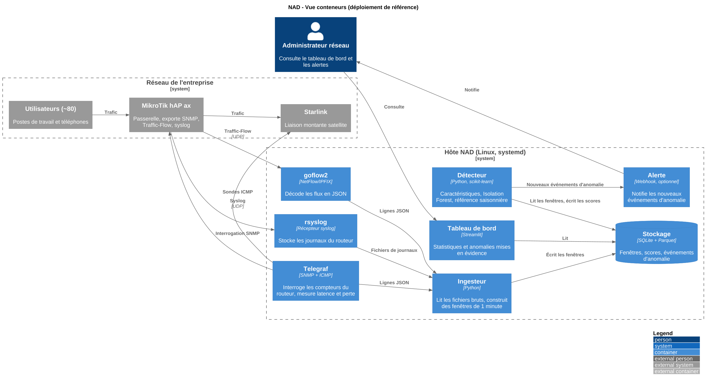

# NAD — Détection d'anomalies réseau

**Français** | [English](README.md)

> Apprend à quoi ressemble un fonctionnement « normal » sur un réseau d'entreprise,
> puis signale automatiquement les comportements inhabituels.

**Statut :** en conception — prototype, pas prêt pour la production

## Pourquoi

Les petits et moyens réseaux ont rarement quelqu'un qui surveille des tableaux de
bord toute la journée. Les seuils d'alerte fixes cessent de fonctionner dès que
l'usage change entre un lundi matin et un dimanche soir. NAD apprend le rythme
normal du réseau à partir de ses propres données et signale ce qui s'en écarte.

## Ce que fait NAD

- Collecte la télémétrie réseau : débit, latence et perte de paquets, flux
  (qui communique avec qui), journaux du routeur.
- Construit une référence (baseline) du comportement normal, y compris les
  cycles quotidiens et hebdomadaires.
- Évalue le nouveau trafic par rapport à cette référence avec un détecteur non
  supervisé.
- Affiche les statistiques et met en évidence les anomalies dans un tableau de
  bord simple.

## Environnement de référence

Environ 80 utilisateurs derrière une passerelle MikroTik hAP ax, avec une liaison
montante Starlink. La passerelle exporte la télémétrie ; NAD tourne sur un hôte
Linux séparé et ne se trouve jamais dans le chemin du trafic.

## Architecture



| Composant | Rôle | Implémentation |
|---|---|---|
| Collecteur SNMP et sondes | Compteurs du routeur, latence, perte de paquets | Telegraf |
| Collecteur de flux | Décode les enregistrements de flux | goflow2 |
| Récepteur de journaux | Stocke les journaux du routeur | rsyslog |
| Ingesteur | Lit les fichiers bruts, normalise en fenêtres temporelles | Python |
| Stockage | Fenêtres, scores, événements d'anomalie, export du jeu de données | SQLite + Parquet |
| Détecteur | Construction des caractéristiques, scoring, référence | Python, scikit-learn |
| Tableau de bord | Statistiques et anomalies mises en évidence | Streamlit |
| Alerte | Notification optionnelle des nouvelles anomalies | Webhook |
| Déploiement | Configure l'hôte de façon reproductible | Ansible + systemd |

## Spécification

### Sources de données

| Source | Contenu | Transport |
|---|---|---|
| Compteurs | Débit des interfaces, CPU, mémoire | Interrogation SNMP |
| Flux | Source, destination, ports, octets, paquets | NetFlow/IPFIX sur UDP |
| Sondes | Temps aller-retour et perte vers plusieurs cibles | ICMP |
| Journaux | Événements du routeur (changements d'interface, connexions) | Syslog sur UDP |

### Fenêtres normalisées

Toutes les sources sont agrégées en fenêtres fixes (1 minute par défaut,
configurable). Une ligne par fenêtre, un seul schéma quel que soit l'équipement
source.

### Caractéristiques (features)

- Trafic : octets et paquets montants/descendants, nombre de flux, ratio
  montant/descendant
- Diversité : hôtes internes distincts, destinations distinctes, ports
  distincts, part du plus gros émetteur
- Qualité de liaison : temps aller-retour (moyenne et p95), perte de paquets,
  par cible
- Santé de l'équipement : CPU, mémoire, nombre d'événements de journal
- Contexte temporel : heure du jour et jour de la semaine (encodage cyclique)

### Détection

- Une Isolation Forest attribue un score à chaque fenêtre par rapport à la
  référence apprise.
- Une référence saisonnière (statistiques par heure de la semaine) détecte les
  écarts que la forêt ne voit pas, car elle n'a aucune notion du temps.
- Les deux scores sont combinés en un seul score d'anomalie ; le seuil est
  configurable.
- Chaque événement d'anomalie enregistre un horodatage, un score et les
  caractéristiques qui y contribuent le plus, afin de pouvoir l'expliquer.
- Les caractéristiques de qualité de la liaison montante sont tenues à part, pour
  distinguer un problème de liaison d'un comportement anormal à l'intérieur du
  réseau.

### Tableau de bord

Séries temporelles avec anomalies mises en évidence, état actuel, plus gros
émetteurs et tableau des événements d'anomalie.

### Exigences non fonctionnelles

- Lecture seule sur les équipements de production : export de télémétrie
  uniquement, aucune modification du routage ni du pare-feu.
- Fonctionne sur un seul hôte Linux modeste.
- Déploiement automatisé et reproductible.
- Aucun identifiant dans le dépôt ; configuration par fichiers d'environnement.
- Les données brutes ne quittent jamais l'hôte ; les données partagées sont
  anonymisées.

## Choix technologiques

| Composant | Choix | Pourquoi | Si l'environnement offre plus |
|---|---|---|---|
| Compteurs et sondes | Telegraf | Uniquement de la configuration, aucun code à maintenir, généré par modèle Ansible | Prometheus avec un exporteur SNMP, ou réutiliser Zabbix/LibreNMS s'ils existent |
| Flux | goflow2 | Léger, écrit en Go, gère NetFlow v9, IPFIX et sFlow | Même collecteur avec un routeur plus puissant ; port miroir + Zeek pour une visibilité plus fine |
| Journaux | rsyslog | Récepteur fiable le plus simple | Loki ou ELK |
| Stockage | SQLite + Parquet | Un fichier, aucune administration, Parquet adapté au ML | TimescaleDB ou VictoriaMetrics ; ClickHouse pour de gros volumes de flux |
| Détecteur | Isolation Forest + référence saisonnière | Peu d'hypothèses, explicable, gère de nombreuses caractéristiques | Ajouter LOF ou One-Class SVM en comparaison |
| Tableau de bord | Streamlit | Contrôle total de l'affichage des anomalies, 100 % Python | Grafana + Alertmanager |
| Déploiement | Ansible + systemd | Un seul hôte, aucune couche de conteneurs à maintenir | Docker Compose sur un serveur |

Le comparatif complet des outils candidats, avec leurs forces et leurs limites,
se trouve dans [`docs/tooling.md`](docs/tooling.md).

## Modes dégradés

Le détecteur n'a besoin que d'un flux normalisé de fenêtres ; la chaîne continue
donc de fonctionner, en mode réduit, quand une source est indisponible :

1. **Pas d'export de flux :** compteurs SNMP et sondes uniquement. Les pics et
   la dérive de latence restent détectés, sans attribution à un hôte.
2. **Pas d'accès au routeur :** capture passive depuis le port miroir d'un
   commutateur.
3. **Pas encore d'historique local :** développer et tester le détecteur sur des
   jeux de données publics et sur un réseau de laboratoire en attendant les
   données réelles.

## Principes de conception

1. **Adaptateurs en périphérie.** Changer de routeur ou de source de données ne
   touche que les collecteurs, pas le reste de la chaîne.
2. **La référence d'abord.** La collecte démarre tôt pour que le détecteur
   s'appuie sur un historique réel.
3. **Non supervisé par défaut.** Aucune attaque étiquetée n'est nécessaire. Les
   anomalies de test injectées servent uniquement à valider la détection.
4. **Lecture seule en production.** NAD ne modifie jamais le routage ni les
   règles de pare-feu.
5. **Reproductible.** Le déploiement est décrit sous forme de code et peut être
   rejoué.

## Périmètre

| Dans le périmètre | Hors périmètre |
|---|---|
| Détection et signalement | Blocage ou remédiation automatiques |
| Métadonnées (compteurs, flux, latence) | Inspection du contenu des paquets |
| Un site, une passerelle | Corrélation multi-sites |

## Structure du dépôt

```
README.md       Documentation (anglais)
README.fr.md    Documentation (français)
Makefile        Raccourcis (make diagrams)
infra/          Automatisation du déploiement (Ansible) et labo optionnel (Terraform)
src/nad/        Code applicatif : collect, features, model, detect
scenarios/      Anomalies injectées avec leurs étiquettes attendues
data/           Local uniquement (ignoré par Git) + petits échantillons anonymisés
docs/           Architecture, outils, rapport
  diagrams/     Sources PlantUML (.puml) et images générées (.png, .svg)
```

## Validation

Des anomalies sont injectées volontairement (pic de trafic, scan de ports,
inondation de connexions) pendant une fenêtre autorisée. La détection est
mesurée par rapport à la chronologie connue : taux de détection et fausses
alertes par jour.

## Sécurité et confidentialité

Les données de flux sont des métadonnées sur l'activité de personnes réelles.
Les données brutes restent hors de Git, et tout jeu de données partagé est
d'abord anonymisé (adresses, noms d'hôtes). L'export de télémétrie sur le
routeur est restreint à l'hôte NAD, avec un compte dédié en lecture seule.

## Feuille de route

- [ ] Télémétrie activée sur la passerelle
- [ ] Collecte en fonctionnement sur l'hôte NAD
- [ ] Ingestion en fenêtres normalisées
- [ ] Détecteur et référence
- [ ] Validation avec anomalies injectées
- [ ] Tableau de bord
- [ ] Déploiement Ansible
- [ ] Automatisation du labo (optionnel)
- [ ] État de l'antenne de liaison montante comme source supplémentaire (optionnel)
