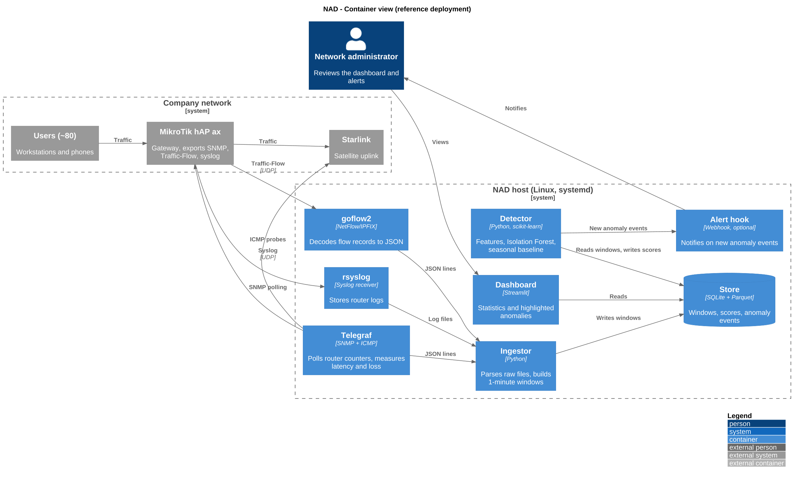

# NAD — Network Anomaly Detection

> Learns what "normal" looks like on a company network, then flags unusual
> behavior automatically.

**Status:** in design — prototype, not production-ready

## Why

Small and mid-size networks rarely have someone watching dashboards all day.
Fixed alert thresholds break as soon as usage changes between a Monday morning
and a Sunday night. NAD learns the normal rhythm of the network from its own
data and reports what deviates from it.

## What it does

- Collects network telemetry: bandwidth, latency and packet loss, flow records
  (who talks to whom), router logs.
- Builds a baseline of normal behavior, including daily and weekly cycles.
- Scores new traffic against that baseline with an unsupervised detector.
- Shows statistics and highlighted anomalies in a simple dashboard.

## Reference environment

About 80 users behind a MikroTik hAP ax gateway, with a Starlink uplink. The
gateway exports telemetry; NAD runs on a separate Linux host and never sits in
the traffic path.

## Architecture



| Component | Responsibility | Implementation |
|---|---|---|
| SNMP and probe collector | Router counters, latency, packet loss | Telegraf |
| Flow collector | Decodes flow records | goflow2 |
| Log receiver | Stores router logs | rsyslog |
| Ingestor | Parses raw files, normalizes into time windows | Python |
| Store | Windows, scores, anomaly events, dataset export | SQLite + Parquet |
| Detector | Feature building, scoring, baseline | Python, scikit-learn |
| Dashboard | Statistics and highlighted anomalies | Streamlit |
| Alert hook | Optional notification on new anomalies | Webhook |
| Deployment | Configures the host reproducibly | Ansible + systemd |

## Specification

### Data sources

| Source | Content | Transport |
|---|---|---|
| Counters | Interface throughput, CPU, memory | SNMP polling |
| Flows | Source, destination, ports, bytes, packets | NetFlow/IPFIX over UDP |
| Probes | Round-trip time and loss to several targets | ICMP |
| Logs | Router events (interface changes, logins) | Syslog over UDP |

### Normalized windows

All sources are aggregated into fixed windows (default 1 minute, configurable).
One row per window, one schema regardless of the source device.

### Features

- Traffic: bytes and packets up/down, flow count, upload/download ratio
- Diversity: distinct internal hosts, distinct destinations, distinct ports,
  share of the top talker
- Link quality: round-trip time (mean and p95), packet loss, per target
- Device health: CPU, memory, log event count
- Time context: hour of day and day of week (cyclical encoding)

### Detection

- An Isolation Forest scores each window against the learned baseline.
- A seasonal baseline (per hour-of-week statistics) catches deviations that the
  forest cannot see because it has no notion of time.
- Both scores are combined into one anomaly score; the threshold is configurable.
- Each anomaly event stores a timestamp, a score and its top contributing
  features, so it can be explained.
- Uplink-quality features are kept separate so that link problems can be told
  apart from misbehavior inside the network.

### Dashboard

Time series with anomalies highlighted, current status, top talkers, and a
table of anomaly events.

### Non-functional requirements

- Read-only on production devices: telemetry export only, no routing or
  firewall changes.
- Runs on a single modest Linux host.
- Deployment is automated and repeatable.
- No credentials in the repository; configuration through environment files.
- Raw data never leaves the host; shared data is anonymized.

## Technology decisions

| Component | Decision | Why | If the environment offers more |
|---|---|---|---|
| Counters and probes | Telegraf | Configuration only, no code to maintain, templated by Ansible | Prometheus with an SNMP exporter, or reuse Zabbix/LibreNMS if present |
| Flows | goflow2 | Lightweight, written in Go, handles NetFlow v9, IPFIX and sFlow | Same collector with a more capable router; mirror port + Zeek for deeper visibility |
| Logs | rsyslog | Simplest reliable receiver | Loki or ELK |
| Store | SQLite + Parquet | One file, no administration, Parquet is ML-friendly | TimescaleDB or VictoriaMetrics; ClickHouse for large flow volumes |
| Detector | Isolation Forest + seasonal baseline | Few assumptions, explainable, handles many features | Add LOF or One-Class SVM as comparisons |
| Dashboard | Streamlit | Full control over anomaly rendering, pure Python | Grafana + Alertmanager |
| Deployment | Ansible + systemd | One host, no container layer to maintain | Docker Compose on a server |

The full comparison of candidate tools, with strengths and limits, is in
[`docs/tooling.md`](docs/tooling.md).

## Fallback modes

The detector only needs a normalized stream of windows, so the pipeline degrades
gracefully when a source is unavailable:

1. **No flow export:** SNMP counters and probes only. Spikes and latency drift
   are still detected, without attribution to a host.
2. **No router access:** passive capture from a switch mirror port.
3. **No local history yet:** develop and test the detector on public datasets
   and on a lab network until real data is available.

## Design principles

1. **Adapters at the edge.** Changing the router or a data source only touches
   the collectors, not the rest of the pipeline.
2. **Baseline first.** Collection starts early so the detector is built on
   real history.
3. **Unsupervised by default.** No labeled attacks are required. Injected test
   anomalies are used only to validate detection.
4. **Read-only on production.** NAD never changes routing or firewall rules.
5. **Reproducible.** Deployment is described as code and can be replayed.

## Scope

| In scope | Out of scope |
|---|---|
| Detection and reporting | Automatic blocking or remediation |
| Metadata (counters, flows, latency) | Packet payload inspection |
| One site, one gateway | Multi-site correlation |

## Repository layout

```
README.md       Documentation (English)
README.fr.md    Documentation (French)
Makefile        Shortcuts (make diagrams)
infra/          Deployment automation (Ansible) and optional lab (Terraform)
src/nad/        Application code: collect, features, model, detect
scenarios/      Injected anomalies with expected labels
data/           Local only (git-ignored) plus small anonymized samples
docs/           Architecture, tooling, report
  diagrams/     PlantUML sources (.puml) and generated images (.png, .svg)
```

## Validation

Anomalies are injected on purpose (traffic spike, port scan, connection flood)
in an authorized window. Detection is measured against the known timeline:
detection rate and false alarms per day.

## Security and privacy

Flow data is metadata about real people's activity. Raw data stays out of Git,
and any shared dataset is anonymized (addresses, hostnames) first. Telemetry
export on the router is restricted to the NAD host, using a dedicated
read-only account.

## Roadmap

- [ ] Telemetry enabled on the gateway
- [ ] Collection running on the NAD host
- [ ] Ingestion into normalized windows
- [ ] Detector and baseline
- [ ] Validation with injected anomalies
- [ ] Dashboard
- [ ] Ansible deployment
- [ ] Lab automation (optional)
- [ ] Uplink dish status as an additional source (optional)
