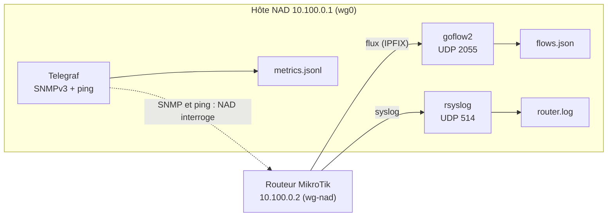

# Guide 01 — Mise en place de la télémétrie et conception de l'ingestion

**Français** | [English](01-telemetry-and-ingestion.md)

**Public :** toute personne qui reproduit le prototype, ou un assistant IA qui
reprend le travail.
**Objectif :** faire circuler une télémétrie réelle du routeur passerelle vers
l'hôte NAD à travers un tunnel privé, puis concevoir l'ingesteur à partir
d'échantillons réels.
**Statut :** en cours.

- Chaîne de collecte (flux, SNMP v3, syslog, sondes) : configurée et en service
  depuis le 2026-10-21.
- Mesure de charge du routeur, recoupement avec les compteurs du routeur et
  ingesteur : pas encore faits.

Remplis le journal des résultats (section 11) au fur et à mesure. Les éléments
marqués **(à vérifier)** dépendent de la version de RouterOS ou de l'outil et
doivent être confrontés à la documentation à jour.

## 1. Pourquoi cet ordre

L'ordre est le suivant : configurer le routeur, préparer l'hôte à recevoir,
capturer des échantillons réels, les recouper, et seulement ensuite écrire
l'ingesteur.

- **Un parseur écrit à partir d'un format imaginé finit réécrit.** Les vrais
  enregistrements de flux ont des noms de champs et des particularités qu'on ne
  découvre qu'après en avoir capturé.
- **Chaque étape produit un résultat visible.** Si quelque chose ne va pas
  (aucun paquet, réponses SNMP vides), tu sais quel maillon de la chaîne est
  cassé.
- **Le recoupement protège tout le projet.** Si les données de flux ne
  correspondent pas à peu près aux compteurs du routeur lui-même, tous les
  résultats suivants seraient bâtis sur du sable.

## 2. Modèle mental

Le routeur et l'hôte NAD sont reliés par un **tunnel WireGuard**. Toute la
télémétrie circule à l'intérieur : l'hôte NAD n'expose donc aucun port de
télémétrie sur Internet.

| Côté | Rôle | Adresse dans le tunnel | Interface |
|---|---|---|---|
| Routeur | Envoie les flux et les journaux, répond au SNMP | 10.100.0.2 | `wg-nad` |
| Hôte NAD (VPS) | Reçoit, collecte, stocke | 10.100.0.1 | `wg0` |



En termes simples : NAD peut *poser des questions* au routeur (SNMP, ping), et le
routeur *envoie* de lui-même deux types de messages (résumés de flux et journaux
d'événements).

| Canal | Sens | Qui l'initie | Contenu | Port | Outil NAD |
|---|---|---|---|---|---|
| SNMP | NAD vers routeur | NAD interroge | Compteurs, CPU, durée de fonctionnement | UDP 161 | Telegraf |
| Sondes | NAD vers routeur | NAD envoie un ping | Latence, pertes | ICMP | Telegraf |
| Flux (IPFIX) | Routeur vers NAD | Le routeur pousse | Résumés des conversations | UDP 2055 | goflow2 |
| Syslog | Routeur vers NAD | Le routeur pousse | Événements (DHCP, Hotspot, erreurs) | UDP 514 | rsyslog |

Ce qui en découle :

- Configurer le routeur revient à lui dire **où envoyer** et **qui peut
  l'interroger**.
- L'hôte doit **écouter avant** que le routeur commence à envoyer. Les
  récepteurs s'attachent à l'adresse du tunnel : le tunnel doit donc être monté
  d'abord, et les services sont ordonnés après `wg-quick@wg0`.
- Les flux et le syslog passent par UDP : il n'y a pas de renvoi, donc des
  paquets peuvent se perdre sans bruit. C'est pour cela qu'un recoupement existe.
- Le pare-feu du fournisseur ne voit que le port UDP du tunnel lui-même, jamais
  les ports de télémétrie qu'il contient. Les ports 2055 et 514 ne sont donc
  **pas** ouverts côté public.
- Le routeur n'est que le **messager** : chaque paquet de flux vient du routeur,
  mais son contenu décrit les conversations de tous les utilisateurs.

## 3. Prérequis

- Un accès au routeur (SSH ou WinBox) avec le droit de modifier les réglages de
  télémétrie.
- Un tunnel WireGuard fonctionnel entre le routeur et l'hôte NAD (sa mise en
  place est hors de ce guide). Vérifie-le depuis l'hôte avec `sudo wg show` et
  `ping -c 3 10.100.0.2`.
- Un hôte Linux avec systemd. Sur l'hôte : `tcpdump`, `jq`, les outils clients
  Net-SNMP (`snmpget`, `snmpwalk` : paquet `snmp` sur Debian/Ubuntu), `rsyslog`,
  `goflow2` et `telegraf`.
- Les horloges synchronisées par NTP sur l'hôte et sur le routeur (étape 1.4).
- Le pare-feu du fournisseur : seuls SSH et le port UDP de WireGuard sont
  ouverts sur Internet, plus les autres services publics que l'hôte fournit.

## 4. Vue d'ensemble du déroulé


En pratique, le côté hôte passe d'abord pour chaque canal : les identifiants
SNMP (étape 2.5) avant l'utilisateur SNMP du routeur (étape 1.2), et le récepteur
de flux (étape 2.3) avant l'export de flux (étape 1.1).

---

## 5. Étape 0 — Filet de sécurité

**Pourquoi :** les changements de télémétrie sont légers, mais une erreur sur
une passerelle peut couper la connectivité. Une sauvegarde et un moyen
d'annuler rendent les changements sûrs.

```
# Modèle, version de RouterOS, stockage libre (journal des résultats)
/system resource print

# Enregistrer la configuration actuelle (before-nad.rsc) et vérifier sa présence
/export file=before-nad
/file print where name~"before-nad"

# FastTrack : aucune ligne sous l'en-tête « Flags » = aucune règle FastTrack
/ip firewall filter print where action=fasttrack-connection

# Organisation du LAN : nom du bridge, ports membres (drapeau H = hardware offload), sous-réseaux
/interface bridge print
/interface bridge port print
/ip address print

# Le tunnel vers l'hôte NAD
/interface wireguard print
/interface wireguard peers print
/ping 10.100.0.1 count=3

# Configuration SNMP existante et chaîne input du pare-feu
/snmp print
/snmp community print
/ip firewall filter print where chain=input
```

Depuis ton poste de travail, télécharge la sauvegarde et garde-la hors du
dépôt, puis supprime-la du routeur :

```bash
mkdir -p ~/nad-private
scp <admin-user>@<router-ip>:before-nad.rsc ~/nad-private/
```

```
/file remove before-nad.rsc
```

- **Mode sûr :** `Ctrl+X` l'active et l'invite affiche `<SAFE>`. Quitter le
  mode sûr avec `Ctrl+X` **garde** les changements ; `Ctrl+D`, ou une session
  coupée, **annule** tout ce qui a été fait depuis son activation.
- **Ne commite pas le fichier d'export.** Il décrit le réseau et contient le
  numéro de série du routeur.
- **Note**, à partir de `/ip address print` : le sous-réseau LAN et les adresses
  de la liaison montante. L'ingesteur en a besoin (étape 5).
- **À propos de FastTrack :** sur les anciennes versions de RouterOS, il
  masquait du trafic à l'export de flux ; la documentation indique que cette
  restriction a été levée en 6.33 **(à vérifier)**. Aucune règle FastTrack
  n'existe sur ce routeur : ce n'est donc pas un facteur.

## 6. Étape 1 — Activer la télémétrie sur le routeur

Vérifie chaque commande avec `?` ou `print`, car la syntaxe peut varier selon la
version de RouterOS **(à vérifier)**.

### 1.1 Flux (qui communique avec qui)

**Pourquoi :** les enregistrements de flux montrent les conversations (source,
destination, ports, octets). C'est le signal le plus riche pour détecter les
scans, les inondations et les destinations inhabituelles.

```
# Activer l'export de flux sur le bridge LAN.
# active-flow-timeout : rapporter les longs transferts chaque minute plutôt qu'à la fin
# inactive-flow-timeout : fermer rapidement les flux inactifs
/ip traffic-flow set enabled=yes interfaces=bridge1 active-flow-timeout=1m inactive-flow-timeout=15s

# Envoyer les flux à l'hôte NAD par le tunnel, IPFIX, UDP 2055.
# src-address fixe la source sur l'adresse du tunnel : l'hôte voit 10.100.0.2.
/ip traffic-flow target add dst-address=10.100.0.1 port=2055 version=ipfix src-address=10.100.0.2

# Vérifier
/ip traffic-flow print
/ip traffic-flow target print
```

**Observé (RouterOS 7.23.8) :** exporter depuis le seul bridge LAN enregistre
**les deux sens**, chaque flux une seule fois. Les flux montants portent
l'adresse du poste interne (`192.168.26.x`). Les flux descendants portent une
adresse traduite (`192.168.1.x`) au lieu de celle du client, car le routeur est
derrière le routeur Starlink (double NAT) **(à vérifier)**. Beaucoup
d'enregistrements sont de simples acquittements TCP de 40 octets : l'ingesteur
doit donc agréger par fenêtre de temps, jamais travailler flux par flux. Le
trafic destiné au routeur lui-même (par exemple le DNS vers `192.168.26.1`)
apparaît aussi.

Si des ports du bridge utilisent le hardware offload, le trafic entre deux ports
LAN est commuté par la puce sans atteindre le CPU : il n'apparaît pas dans les
flux. C'est une limite connue, acceptable car l'essentiel du trafic va vers
Internet.

### 1.2 SNMP (compteurs et santé de l'équipement)

**Pourquoi :** SNMP fournit le débit des interfaces, le CPU et la durée de
fonctionnement. C'est aussi la référence qui sert à vérifier les données de
flux.

Génère d'abord les phrases de passe sur l'hôte (étape 2.5), puis, sur le
routeur :

**a) Regarder l'existant.** Note si une communauté `public` existe et quelles
adresses elle accepte.

```
/snmp print
/snmp community print
```

**b) Désactiver la communauté par défaut, avant d'activer le service.**
`public` est le nom par défaut que tout le monde connaît, ouvert à toutes les
adresses, sans chiffrement.

```
# Les entrées par défaut ne peuvent en général pas être supprimées, donc on la désactive (à vérifier)
/snmp community disable [find name=public]

# Vérifier : la ligne « public » doit porter un X (désactivée)
/snmp community print
```

Si la commande est refusée, restreins-la plutôt :
`/snmp community set [find name=public] addresses=10.100.0.1/32`.

**c) Créer l'utilisateur SNMPv3** (une seule ligne ; `<AUTH>` et `<PRIV>` sont les
phrases de passe générées à l'étape 2.5) :

```
/snmp community add name=nad-ro addresses=10.100.0.1/32 read-access=yes write-access=no security=private authentication-protocol=SHA1 authentication-password=<AUTH> encryption-protocol=AES encryption-password=<PRIV>
```

Dans RouterOS, `/snmp community` contient des profils d'accès. Avec
`security=private`, l'entrée est un **utilisateur SNMPv3** (authentifié et
chiffré), et `name` devient le nom d'utilisateur. Le nom d'utilisateur et les
deux phrases de passe doivent être identiques dans cette entrée du routeur et
dans `/etc/default/telegraf` sur l'hôte (étape 2.5). Les versions récentes de
RouterOS proposent des algorithmes plus forts que SHA1 **(à vérifier)** ; si tu
en choisis un, change aussi `auth_protocol` dans la configuration de Telegraf.

**d) Activer le service et vérifier :**

```
/snmp set enabled=yes
/snmp print
/snmp community print
```

`nad-ro` doit être actif et restreint à `10.100.0.1/32` ; `public` doit être
désactivée.

**Observé :** la description système renvoyée par SNMP est
`RouterOS RB1100x4 7.23.8 (long-term)`, et le nom du routeur est `MikroTikH05`.

### 1.3 Syslog (événements)

**Pourquoi :** les événements de l'équipement (DHCP, connexions Hotspot, échecs
de connexion, changements d'interface) apportent un contexte utile. NAD les
utilise sous forme de comptages par fenêtre de temps.

```
# Définir une destination : l'hôte NAD par le tunnel, UDP 514.
# syslog-time-format accepte bsd-syslog ou iso8601 (à vérifier)
/system logging action add name=nad target=remote remote=10.100.0.1 remote-port=514 src-address=10.100.0.2 syslog-facility=local0 syslog-time-format=bsd-syslog

# L'action définit seulement OÙ envoyer. Ces règles définissent QUOI envoyer
/system logging add topics=info action=nad
/system logging add topics=warning action=nad
/system logging add topics=error action=nad
/system logging add topics=critical action=nad
/system logging add topics=firewall action=nad

# Vérifier
/system logging action print
/system logging print
```

Notes :

- Le topic `firewall` ne produit des lignes que pour les règles de pare-feu qui
  ont `log=yes`.
- Le topic `info` est bavard : les événements DHCP et Hotspot dominent. Ces
  lignes contiennent des adresses MAC et des identifiants de connexion, qui sont
  des données personnelles : voir les permissions et la rétention à l'étape 2.4.

### 1.4 Heure

**Pourquoi :** NAD agrège tout en fenêtres d'une minute. Si l'horloge du routeur
est décalée, ses données tombent dans la mauvaise fenêtre.

```
# Fuseau horaire du site (UTC+3, pas de changement d'heure)
/system clock set time-zone-name=Indian/Antananarivo

# Vérifier que l'horloge est juste et synchronisée
/system clock print
/system ntp client print
```

### 1.5 Annuler

**Flux :**

```
# Supprimer la cible d'export et remettre les valeurs par défaut (vérifie les valeurs par défaut)
/ip traffic-flow target remove [find dst-address=10.100.0.1]
/ip traffic-flow set enabled=no interfaces=all active-flow-timeout=30m inactive-flow-timeout=15s
```

**Syslog :**

```
/system logging remove [find action=nad]
/system logging action remove [find name=nad]
```

**SNMP, seulement s'il faut le retirer complètement :**

```
/snmp set enabled=no
/snmp community remove [find name=nad-ro]
```

Même dans ce cas, laisse `public` désactivée : c'est plus sûr que l'état
d'origine.

---

## 7. Étape 2 — Installer les récepteurs sur l'hôte

**Pourquoi :** le routeur pousse les flux et le syslog sans attendre. Si rien
n'écoute, ces messages sont perdus. Pour SNMP, c'est l'hôte qui interroge : il
lui faut les identifiants avant que l'utilisateur existe sur le routeur.

### 2.1 Paquets, utilisateur de service et dossiers

```bash
sudo apt-get update && sudo apt-get install -y rsyslog jq tcpdump snmp sqlite3 curl gpg

# Un utilisateur système sans connexion pour les fichiers des collecteurs
sudo useradd --system --no-create-home --shell /usr/sbin/nologin nad

# Fichiers de flux bruts (écrits par goflow2, lisibles par nad et root uniquement)
sudo install -d -o nad -g nad -m 750 /var/lib/nad /var/lib/nad/flows

# Journaux du routeur (écrits par rsyslog)
sudo install -d -o syslog -g adm /var/log/mikrotik
```

Le dossier de télémétrie de Telegraf est créé à l'étape 2.5, une fois que le
paquet a créé son utilisateur.

### 2.2 Exposition réseau

- **Pare-feu du fournisseur (filtre principal) :** n'ouvre que SSH, le port UDP
  de WireGuard (`sudo wg show wg0 listen-port`) et ce que l'hôte sert
  publiquement. Garde UDP 514 et UDP 2055 **fermés** : la télémétrie arrive à
  l'intérieur du tunnel.
- **Écoute sur l'adresse du tunnel :** chaque récepteur n'écoute que sur
  `10.100.0.1` (voir les configurations plus bas) : même une règle de pare-feu
  erronée ne l'exposerait pas. Vérifie avec :

```bash
sudo ss -lunp | grep -E ':(514|2055)\b'
```

- **Pare-feu de l'hôte (seconde couche, facultatif) :** si `ufw` est activé,
  autorise seulement le routeur, par le tunnel, et place les règles SSH et
  WireGuard avant de l'activer :

```bash
sudo ufw allow in on wg0 from 10.100.0.2 to 10.100.0.1 port 2055 proto udp
sudo ufw allow in on wg0 from 10.100.0.2 to 10.100.0.1 port 514 proto udp
```

### 2.3 Récepteur de flux (goflow2)

Installe goflow2 avec Go, ou à partir d'un binaire publié :

```bash
# Option A : compiler avec Go (Go récent requis)
go install github.com/netsampler/goflow2/v2/cmd/goflow2@latest
sudo install -m 755 ~/go/bin/goflow2 /usr/local/bin/goflow2

# Option B : binaire publié sur https://github.com/netsampler/goflow2/releases
# sudo install -m 755 ./goflow2 /usr/local/bin/goflow2
```

Teste d'abord au premier plan, pour voir les erreurs :

```bash
# Les noms d'options changent selon les versions : vérifie avec goflow2 -h (à vérifier)
sudo goflow2 -listen "netflow://10.100.0.1:2055" -addr "127.0.0.1:9101"
```

`-addr` déplace le serveur de métriques propre à goflow2, qui écoute par défaut
sur le port 8080 ; un autre service de l'hôte utilise déjà ce port. Quelques
avertissements `template error` au démarrage sont normaux : les données IPFIX ne
peuvent pas être décodées avant que le routeur envoie son template (à l'export
suivant). Ensuite, des lignes JSON apparaissent.

Installe-le comme service, ordonné après le tunnel :

```bash
sudo tee /etc/systemd/system/goflow2.service <<'EOF'
[Unit]
Description=goflow2 IPFIX collector (NAD)
After=network-online.target wg-quick@wg0.service
Wants=network-online.target
Requires=wg-quick@wg0.service

[Service]
User=nad
ExecStart=/usr/local/bin/goflow2 -listen "netflow://10.100.0.1:2055" -addr 127.0.0.1:9101 -format json -transport file -transport.file /var/lib/nad/flows/flows.json
Restart=on-failure
RestartSec=5

[Install]
WantedBy=multi-user.target
EOF
sudo systemctl daemon-reload && sudo systemctl enable --now goflow2
systemctl status goflow2 --no-pager
```

L'état doit être `active (running)`. S'il redémarre en boucle, lis la cause avec
`sudo journalctl -u goflow2 -n 20 --no-pager`.

**Rotation (obligatoire) :** le fichier brut grossit de 10 à 16 Mo par minute
(section 8). `logrotate` l'archive et le compresse quand il dépasse 200 Mo, et
`cron` le vérifie toutes les 5 minutes :

```bash
sudo tee /etc/logrotate.d/nad-flows <<'EOF'
/var/lib/nad/flows/flows.json {
    size 200M
    rotate 300
    compress
    copytruncate
    missingok
    notifempty
}
EOF
echo '*/5 * * * * root /usr/sbin/logrotate /etc/logrotate.d/nad-flows' | sudo tee /etc/cron.d/nad-flows
systemctl is-active cron
```

`copytruncate` copie le fichier puis le vide sur place : goflow2 continue
d'écrire sans redémarrage ; quelques lignes écrites pendant la copie peuvent
être perdues, ce qui est acceptable ici. Avec `rotate 300`, l'historique est de
deux à trois jours pour quelques Go au plus. Vérifie avec
`sudo logrotate -d /etc/logrotate.d/nad-flows` puis, au bout d'environ 20
minutes, `sudo ls -lh /var/lib/nad/flows/` (un `flows.json.1.gz` d'environ 5 à
6 Mo doit apparaître).

Le dossier est en `750` : lis ces fichiers avec `sudo`.

### 2.4 Récepteur syslog (rsyslog)

```bash
sudo tee /etc/rsyslog.d/10-mikrotik.conf <<'EOF'
# Écouter le syslog uniquement sur l'adresse du tunnel
module(load="imudp")
input(type="imudp" port="514" address="10.100.0.1")

# Les messages du routeur vont dans leur propre fichier ; « stop » les tient à
# l'écart du journal système général. Le fichier n'est lisible que par root et
# le groupe adm.
if ($fromhost-ip == '10.100.0.2') then {
    action(type="omfile" file="/var/log/mikrotik/router.log" fileGroup="adm" fileCreateMode="0640")
    stop
}
EOF

# rsyslog s'attache à l'adresse du tunnel : wg0 doit donc être monté d'abord
sudo mkdir -p /etc/systemd/system/rsyslog.service.d
sudo tee /etc/systemd/system/rsyslog.service.d/wait-wg.conf <<'EOF'
[Unit]
After=wg-quick@wg0.service
Wants=wg-quick@wg0.service
EOF

sudo systemctl daemon-reload
sudo systemctl restart rsyslog
```

Test : sur le routeur, lance `/log info "test nad"`, puis sur l'hôte :

```bash
sudo tail -f /var/log/mikrotik/router.log
```

**Rotation et rétention :** le fichier contient des adresses MAC et des
identifiants de connexion : garde-le peu de temps (14 jours ici) :

```bash
ls /usr/lib/rsyslog/rsyslog-rotate
sudo tee /etc/logrotate.d/mikrotik <<'EOF'
/var/log/mikrotik/router.log {
    daily
    rotate 14
    compress
    missingok
    notifempty
    postrotate
        /usr/lib/rsyslog/rsyslog-rotate
    endscript
}
EOF
sudo logrotate -d /etc/logrotate.d/mikrotik
```

Si le script d'aide n'existe pas, remplace le bloc `postrotate` par
`copytruncate`. Si le fichier reste vide, vérifie que l'adresse du routeur dans
le filtre correspond, que rsyslog écoute bien sur `10.100.0.1` (`ss -lunp`), et
que `wg0` était monté au démarrage de rsyslog.

### 2.5 SNMP et sondes (Telegraf)

Telegraf interroge le routeur toutes les 60 secondes (SNMP et ping) et écrit les
réponses sous forme d'une ligne JSON par mesure.

**Installation** depuis le dépôt de l'éditeur (vérifie les commandes avec la
page d'installation à jour **(à vérifier)**) :

```bash
sudo mkdir -p /etc/apt/keyrings
curl -fsSL https://repos.influxdata.com/influxdata-archive.key | sudo gpg --dearmor -o /etc/apt/keyrings/influxdata-archive.gpg
echo "deb [signed-by=/etc/apt/keyrings/influxdata-archive.gpg] https://repos.influxdata.com/debian stable main" | sudo tee /etc/apt/sources.list.d/influxdata.list
sudo apt-get update && sudo apt-get install -y telegraf
telegraf --version
```

**Dossier de sortie.** Telegraf doit pouvoir entrer dans `/var/lib/nad` (groupe
`nad`) et écrire dans son propre sous-dossier :

```bash
sudo usermod -aG nad telegraf
sudo install -d -o telegraf -g nad -m 755 /var/lib/nad/telemetry
id telegraf
```

Un changement de groupe ne s'applique qu'au (re)démarrage du service.

**Identifiants.** Génère deux phrases de passe (Net-SNMP exige au moins 8
caractères) et range-les dans un fichier lisible seulement par root et
Telegraf. Ne les tape jamais directement dans une commande : elles se
retrouveraient dans l'historique du shell et dans `ps`.

```bash
openssl rand -base64 24 | tr -d '/+=' | head -c 20; echo   # AUTH
openssl rand -base64 24 | tr -d '/+=' | head -c 20; echo   # PRIV

sudoedit /etc/default/telegraf
```

```
SNMP_USER=nad-ro
SNMP_AUTH_PASS=<AUTH>
SNMP_PRIV_PASS=<PRIV>
```

```bash
sudo chown root:telegraf /etc/default/telegraf
sudo chmod 640 /etc/default/telegraf
```

Utilise les mêmes valeurs pour l'utilisateur du routeur (étape 1.2 c). Le
service Telegraf lit ce fichier tout seul.

**Configuration.** Pars d'un fichier principal minimal (celui du paquet active
beaucoup de plugins inutiles) :

```bash
sudo mv /etc/telegraf/telegraf.conf /etc/telegraf/telegraf.conf.orig
sudo tee /etc/telegraf/telegraf.conf <<'EOF'
[agent]
  interval = "60s"
  round_interval = true
  flush_interval = "60s"
  omit_hostname = true
EOF
```

SNMP : durée de fonctionnement, CPU par cœur et compteurs d'interface. Les OID
numériques fonctionnent sans fichiers MIB :

```bash
sudo tee /etc/telegraf/telegraf.d/10-snmp.conf <<'EOF'
[[inputs.snmp]]
  agents = ["udp://10.100.0.2:161"]
  version = 3
  sec_name = "${SNMP_USER}"
  sec_level = "authPriv"
  auth_protocol = "SHA"
  auth_password = "${SNMP_AUTH_PASS}"
  priv_protocol = "AES"
  priv_password = "${SNMP_PRIV_PASS}"
  timeout = "5s"
  retries = 2
  name = "router"

  [[inputs.snmp.field]]
    name = "uptime"
    oid = "1.3.6.1.2.1.1.3.0"

  [[inputs.snmp.table]]
    name = "router_cpu"
    index_as_tag = true
    [[inputs.snmp.table.field]]
      name = "cpu_load"
      oid = "1.3.6.1.2.1.25.3.3.1.2"

  [[inputs.snmp.table]]
    name = "router_if"
    [[inputs.snmp.table.field]]
      name = "ifName"
      oid = "1.3.6.1.2.1.31.1.1.1.1"
      is_tag = true
    [[inputs.snmp.table.field]]
      name = "in_octets"
      oid = "1.3.6.1.2.1.31.1.1.1.6"
    [[inputs.snmp.table.field]]
      name = "out_octets"
      oid = "1.3.6.1.2.1.31.1.1.1.10"
    [[inputs.snmp.table.field]]
      name = "in_errors"
      oid = "1.3.6.1.2.1.2.2.1.14"
    [[inputs.snmp.table.field]]
      name = "out_errors"
      oid = "1.3.6.1.2.1.2.2.1.20"
    [[inputs.snmp.table.field]]
      name = "oper_status"
      oid = "1.3.6.1.2.1.2.2.1.8"
EOF
```

Sonde : le routeur, par le tunnel (le ping traverse la liaison Starlink, c'est
donc la vue la plus directe de cette liaison depuis l'hôte). Des cibles Internet
mesureraient la connexion de l'hôte, pas celle du site : sonde-les plus tard
depuis une machine du réseau local du site.

```bash
sudo tee /etc/telegraf/telegraf.d/20-probes.conf <<'EOF'
[[inputs.ping]]
  urls = ["10.100.0.2"]
  count = 5
  ping_interval = 1.0
EOF
```

Sortie : une ligne JSON par mesure, avec rotation intégrée :

```bash
sudo tee /etc/telegraf/telegraf.d/90-output.conf <<'EOF'
[[outputs.file]]
  files = ["/var/lib/nad/telemetry/metrics.jsonl"]
  data_format = "json"
  rotation_interval = "24h"
  rotation_max_archives = 7
EOF
```

**Essai à blanc.** `--test` interroge le routeur une fois et affiche le résultat
sans rien écrire. Il ne lit pas `/etc/default/telegraf` : charge donc les
variables dans le même shell :

```bash
sudo bash -c 'set -a; . /etc/default/telegraf; telegraf --test --config /etc/telegraf/telegraf.conf --config-directory /etc/telegraf/telegraf.d'
```

Attends-toi à des lignes commençant par `ping`, `router`, `router_cpu` et
`router_if`. Un avertissement à propos de `agent_host_tag` est sans conséquence.

**Démarrer et vérifier :**

```bash
sudo systemctl restart telegraf
systemctl status telegraf --no-pager
sleep 70
sudo tail -n 1 /var/lib/nad/telemetry/metrics.jsonl | jq .
```

Utilise `restart` et non `enable --now`, pour que le nouveau groupe soit pris en
compte. Le dernier horodatage peut retarder jusqu'à environ 90 secondes sur
l'heure actuelle (`date +%s`), car Telegraf n'écrit qu'une fois par minute.
Surveille aussi la mémoire pendant quelques minutes
(`ps -o rss=,etime= -C telegraf`) : environ 280 Mo est normal sur cet hôte, et
l'important est qu'elle reste stable.

### 2.6 Vérification de bout en bout

```bash
systemctl is-active goflow2 telegraf rsyslog cron
systemctl is-enabled goflow2 telegraf rsyslog cron wg-quick@wg0
sudo ss -lunp | grep -E ':(514|2055)\b'
sudo wc -l /var/lib/nad/flows/flows.json
sudo tail -n 200 /var/lib/nad/telemetry/metrics.jsonl | jq -r '.name' | sort | uniq -c
sudo tail -n 2 /var/log/mikrotik/router.log
```

Attends-toi à : tous les services actifs et activés au démarrage, goflow2 et
rsyslog attachés à `10.100.0.1`, un fichier de flux qui grossit, les quatre noms
de mesure (`ping`, `router`, `router_cpu`, `router_if`) et des lignes de journal
récentes. Si un service a été arrêté, ses données ont un trou : note la
période, car l'ingesteur doit la traiter comme une donnée manquante (étape 5).

---

## 8. Étape 3 — Capturer des échantillons réels

**Pourquoi :** ce sont les vrais enregistrements qui serviront à concevoir
l'ingesteur.

- Laisse tourner les récepteurs un moment, pendant une utilisation normale du
  réseau.
- Garde les captures brutes **hors de Git**. Seul un petit extrait anonymisé a
  sa place dans `data/samples/`.
- Inspecte un enregistrement pour connaître les noms des champs, puis résume la
  capture :

```bash
F=/var/lib/nad/flows/flows.json

# Afficher joliment le premier enregistrement de flux
sudo head -n 1 $F | jq .

# Répartition par sens (adapte le préfixe LAN)
sudo jq -r 'if (.src_addr|startswith("192.168.26.")) then "montant"
            elif (.dst_addr|startswith("192.168.26.")) then "vers-lan"
            else "autre" end' $F | sort | uniq -c

# Nombre de postes internes distincts vus
sudo jq -r 'select(.src_addr|startswith("192.168.26.")) | .src_addr' $F | sort -u | wc -l

# Index d'interface qui apparaissent de chaque côté
sudo jq -r '[.in_if,.out_if] | @tsv' $F | sort | uniq -c | sort -rn | head

# Échantillon de développement tiré d'une archive (ne touche pas au fichier actif)
mkdir -p ~/nad-samples
sudo zcat /var/lib/nad/flows/flows.json.1.gz | head -n 50000 > ~/nad-samples/flows-sample.jsonl
sudo chown $USER ~/nad-samples/flows-sample.jsonl && chmod 600 ~/nad-samples/flows-sample.jsonl
```

**Volume :** chaque ligne JSON brute fait environ 1 Ko, en majorité des champs
inutiles (BGP, MPLS, IPv6). Sur ce réseau, cela représente **10 à 16 Mo par
minute**, de l'ordre de 15 à 23 Go de JSON brut par jour. Gzip le réduit d'un
facteur 30 à 40 (environ 200 Mo deviennent 6 Mo), d'où la rotation de l'étape
2.3 et la sélection des champs dans l'ingesteur.

Une session de test valide la **chaîne de traitement**, pas la référence. La
référence sera construite plus tard à partir de la collecte continue.

## 9. Étape 4 — Mesure de charge et recoupement

Les deux mesures utilisent les fichiers que Telegraf écrit déjà : aucune phrase
de passe n'est tapée dans une commande.

### 4.1 Charge du routeur (phases A/B/C)

**Pourquoi :** l'export de flux coûte du CPU sur une passerelle qui sert toute
l'entreprise. Un seul relevé ne suffit pas : la charge varie avec l'usage. Trois
phases de 10 minutes chacune, mesurées de la même façon, séparent le coût de
l'export de la variation naturelle :

| Phase | Export de flux | Rôle |
|---|---|---|
| A | Éteint | Charge de référence |
| B | Allumé | Charge avec l'export |
| C | Éteint à nouveau | Vérifie que la charge revient à la référence (contrôle) |

Bascule avec `/ip traffic-flow set enabled=no` puis `enabled=yes`. Évite les gros
téléchargements pendant la mesure, et enchaîne les trois phases à une heure
comparable de la journée. Note le début et la fin de chaque phase en heure Unix
(`date -u +%s` sur l'hôte), puis calcule par phase (Telegraf écrit un relevé par
cœur et par minute) :

```bash
S=<debut-epoch>; E=<fin-epoch>
sudo jq -r --argjson s $S --argjson e $E \
  'select(.name=="router_cpu" and .timestamp>=$s and .timestamp<$e) | [.timestamp, .fields.cpu_load] | @tsv' \
  /var/lib/nad/telemetry/metrics.jsonl \
  | awk '{c+=$2; if ($2>m) m=$2; n++} END {printf "releves=%d cpu_moy=%.1f coeur_max=%d\n", n, c/n, m}'
```

Le cœur le plus chargé compte : un cœur peut saturer alors que la moyenne paraît
basse. La mémoire du routeur n'est pas encore collectée (l'ajout de la table de
stockage est prévu, étape 13).

### 4.2 Recouper les flux avec SNMP

**Pourquoi :** l'export de flux peut sous-compter (hardware offload) ou
sur-compter (le même trafic exporté depuis plusieurs interfaces), et UDP peut
perdre des paquets. Les compteurs SNMP viennent de l'interface elle-même et
servent de référence. **Pas encore testé.**

Utilise uniquement le bridge LAN : ses deux compteurs couvrent les deux sens, et
contrairement à la liaison montante, ils excluent l'encapsulation du tunnel et le
trafic refusé par le pare-feu.

| Compteur SNMP du bridge LAN | Correspond aux flux avec | Sens |
|---|---|---|
| `in_octets` (ce que les machines du LAN envoient) | `in_if` = index de l'interface LAN | Montant |
| `out_octets` (ce que le routeur leur livre) | `out_if` = index de l'interface LAN | Descendant |

Trouve d'abord l'index d'interface du bridge LAN (l'index est le dernier nombre
de l'OID ; les phrases de passe viennent du fichier d'environnement, et
apparaissent dans `ps` le temps de la commande) :

```bash
sudo bash -c 'set -a; . /etc/default/telegraf; snmpwalk -v3 -l authPriv -u "$SNMP_USER" -a SHA -A "$SNMP_AUTH_PASS" -x AES -X "$SNMP_PRIV_PASS" 10.100.0.2 1.3.6.1.2.1.31.1.1.1.1'
```

Compare ensuite deux relevés consécutifs de `bridge1` par Telegraf avec les flux
qui se sont terminés dans le même intervalle :

```bash
B=<lan-ifindex>

# Compteurs : prends deux horodatages espacés d'environ 5 minutes et soustrais
sudo jq -r 'select(.name=="router_if" and .tags.ifName=="bridge1") | [.timestamp,.fields.in_octets,.fields.out_octets] | @tsv' \
  /var/lib/nad/telemetry/metrics.jsonl | tail -n 8

# Flux : octets par sens entre les deux mêmes horodatages
T1=<premier-horodatage>; T2=<second-horodatage>
sudo jq -r --argjson b $B --argjson s $T1 --argjson e $T2 \
  'select((.time_flow_end_ns/1e9)>=$s and (.time_flow_end_ns/1e9)<$e)
   | [(if .in_if==$b then "montant" elif .out_if==$b then "descendant" else "autre" end), .bytes] | @tsv' \
  /var/lib/nad/flows/flows.json | awk '{a[$1]+=$2} END {for (k in a) print k, a[k]}'
```

Compare chaque différence de compteur avec le total correspondant. Attends-toi à
un accord approximatif, pas à une égalité : les compteurs du bridge incluent
aussi le trafic vers et depuis le routeur lui-même (DNS, administration,
interrogation SNMP) et l'encapsulation Ethernet, que les flux ne comptent pas.
Un grand écart renvoie à l'une des causes de la section 12.

## 10. Étape 5 — Concevoir l'ingesteur

### Principe

En termes simples, l'ingesteur est un centre de tri. Il lit les fichiers bruts,
dépose chaque événement dans la boîte de sa minute, compte ce que contient
chaque boîte, et écrit une ligne par boîte.

Quatre étapes, indépendantes les unes des autres pour qu'on puisse remplacer une
source sans toucher au reste :

1. **Lire :** un adaptateur par source (flux, mesures Telegraf, journaux).
2. **Normaliser :** convertir chaque événement dans une forme interne commune
   (horodatage UTC, sens, octets, adresses).
3. **Agréger :** affecter les événements à des fenêtres d'une minute et calculer
   les caractéristiques.
4. **Écrire :** enregistrer une ligne par fenêtre dans la base de données.

### Décisions de conception

| Décision | Pourquoi |
|---|---|
| Tous les horodatages en UTC, fenêtres alignées sur la minute ; la baseline hebdomadaire est calculée dans le fuseau du site (`Indian/Antananarivo`, UTC+3, pas de changement d'heure) | Les utilisateurs suivent leur propre horloge ; le fuseau de l'hôte et son changement d'heure ne doivent jamais compter |
| Fermer une fenêtre seulement après un délai | Les flux arrivent en retard (délais du routeur) ; fermer immédiatement sous-compterait |
| Écritures idempotentes (upsert sur la clé de fenêtre) | Relancer l'ingesteur ne doit jamais dupliquer de lignes |
| Mémoriser la position de lecture par fichier, et lire aussi les archives | Les fichiers tournent toutes les 15 à 20 minutes ; un arrêt ne doit ni sauter ni répéter des données |
| Une fenêtre sans donnée collectée est stockée comme manquante, jamais comme zéro | Un service arrêté crée un trou qui ne doit pas passer pour un réseau silencieux |
| Les compteurs SNMP sont cumulatifs : utiliser la différence entre deux relevés consécutifs, et écarter les différences négatives | Les compteurs repartent de zéro quand le routeur redémarre |
| Sens déterminé par `in_if`/`out_if`, pas par les adresses | Les flux portent des index d'interface ; le côté liaison montante est stable |
| Garder une table de correspondance entre index et nom d'interface | Les flux portent des index, Telegraf des noms (prévu : `index_as_tag`, étape 13) |
| Caractéristiques par hôte calculées sur les flux montants uniquement | Les flux descendants portent une adresse traduite, pas celle du client |
| Classes d'adresses en configuration : interne (LAN), amont (LAN du routeur Starlink), tunnel d'administration | Le trafic amont et d'administration n'est ni celui des utilisateurs internes ni Internet |
| Ne garder que les champs utiles dès la lecture | Les enregistrements bruts font ~1 Ko, surtout des champs inutiles |
| Affecter un flux à la fenêtre de son heure de fin | Simple et déterministe ; avec un délai actif d'une minute, un flux ne s'étend jamais sur plus de deux fenêtres |

Champs utilisés dans goflow2 : `time_flow_start_ns`, `time_flow_end_ns`,
`src_addr`, `dst_addr`, `src_port`, `dst_port`, `proto`, `bytes`, `packets`,
`in_if`, `out_if`, `tcp_flags`, `sampler_address`. Les horodatages sont en
nanosecondes.

Mesures Telegraf utilisées : `router_if` (étiquette `ifName` ; champs
`in_octets`, `out_octets`, `in_errors`, `out_errors`, `oper_status`),
`router_cpu` (étiquette `index` ; champ `cpu_load`), `router` (`uptime`) et
`ping` (`average_response_ms`, `minimum_response_ms`, `maximum_response_ms`,
`percent_packet_loss`, `result_code`). Les horodatages sont en secondes Unix.

Exemple de configuration (valeurs du réseau de référence) :

```yaml
internal_subnets:
  - 192.168.26.0/24   # LAN utilisateurs
upstream_subnets:
  - 192.168.1.0/24    # LAN du routeur Starlink (ni interne, ni Internet)
management_subnets:
  - 10.100.0.0/24     # Tunnel WireGuard entre le routeur et l'hôte NAD
lan_interface: bridge1   # index à résoudre (16 observé côté LAN dans les flux)
wan_interface: ether1    # index 1 observé côté liaison montante, à confirmer
timezone: Indian/Antananarivo
```

### Schéma provisoire (à ajuster après avoir vu de vrais enregistrements)

```sql
-- Une ligne par fenêtre d'une minute, issue des flux, des compteurs et des journaux
CREATE TABLE IF NOT EXISTS windows (
  window_start      INTEGER PRIMARY KEY,  -- secondes unix, UTC, alignées sur la minute
  flows             INTEGER,
  bytes_up          INTEGER,
  bytes_down        INTEGER,
  packets_up        INTEGER,
  packets_down      INTEGER,
  distinct_hosts    INTEGER,              -- à partir des flux montants
  distinct_dests    INTEGER,
  distinct_ports    INTEGER,
  top_talker_share  REAL,                 -- à partir des flux montants
  cpu_pct           REAL,                 -- moyenne des cœurs
  cpu_core_max_pct  REAL,                 -- cœur le plus chargé
  log_events        INTEGER,
  data_complete     INTEGER,              -- 0 si une source avait un trou dans cette fenêtre
  ingested_at       INTEGER
);

-- Une ligne par fenêtre et par cible de sonde (plusieurs cibles par fenêtre plus tard)
CREATE TABLE IF NOT EXISTS probe_windows (
  window_start  INTEGER,
  target        TEXT,                     -- ex. l'adresse du routeur dans le tunnel
  rtt_mean_ms   REAL,
  rtt_p95_ms    REAL,
  loss_pct      REAL,
  PRIMARY KEY (window_start, target)
);
```

Les sondes ont leur propre table, car chaque fenêtre a une ligne par cible.
Sonder à la fois le tunnel et, plus tard, des cibles Internet depuis le site
permet de distinguer un problème de liaison locale d'un problème de liaison
satellite.

## 11. Journal des résultats

Remplis-le après chaque session. Ces valeurs alimentent les décisions de
`docs/tools/tooling.fr.md`.

| Élément | Valeur |
|---|---|
| Modèle du routeur et version de RouterOS | RB1100x4, RouterOS 7.23.8 (long-term), nom `MikroTikH05` (d'après SNMP) |
| Fuseau horaire du routeur | `Indian/Antananarivo`, UTC+3, pas de changement d'heure |
| Hôte NAD | VPS de 8 Go de RAM, systemd, fuseau Europe/Paris (CEST), synchronisé par NTP |
| Tunnel | WireGuard, routeur 10.100.0.2 (`wg-nad`) vers hôte 10.100.0.1 (`wg0`) ; ping à travers environ 211 ms en moyenne, 0 % de perte |
| FastTrack activé | Non (aucune règle configurée) |
| LAN | `bridge1`, 192.168.26.0/24, routeur 192.168.26.1 ; serveur DHCP et Hotspot actifs |
| Interfaces vues par SNMP | Entre autres `ether4`, `ether7`, `ether8`, `ether11` à `ether13`, `bridge1`, `bridge2`, `wg-nad`, `lo` |
| Export de flux | IPFIX depuis `bridge1` seul, délais 1 m / 15 s ; valeurs de `in_if`/`out_if` : 16 (côté LAN) et 1 (côté liaison montante), noms à confirmer |
| Adresses dans les flux | Montants : postes internes (192.168.26.x). Descendants : adresse traduite (192.168.1.x), à confirmer |
| Volume brut des flux | Environ 1 Ko par ligne, 10 à 16 Mo par minute (15 à 23 Go par jour) ; gzip 30 à 40 fois plus petit |
| Telegraf | Version 1.40.2, intervalle de 60 s, environ 280 Mo de RAM, stable sur 25 minutes |
| Compteurs du tunnel | `wg-nad` affiche 988 erreurs en sortie le 2026-10-21 (à surveiller) |
| Format syslog observé | `<heure avec décalage> <adresse du routeur dans le tunnel> <topics> <message>`, horodaté à la réception dans le fuseau local de l'hôte **(à vérifier)** |
| Charge du routeur, export éteint contre allumé | Pas encore mesurée |
| Flux contre compteurs SNMP (ratio) | Pas encore mesuré |
| Notes | Double NAT derrière le routeur Starlink ; le topic `info` est dominé par les événements DHCP et Hotspot |

## 12. Dépannage

### Flux

| Symptôme | Cause probable | À vérifier |
|---|---|---|
| Aucun paquet dans `tcpdump -ni wg0 udp port 2055` | Routeur qui n'exporte pas, tunnel coupé, mauvaise adresse cible | `/ip traffic-flow target print` ; `ping 10.100.0.2` ; `sudo wg show` |
| goflow2 s'arrête au démarrage avec « address already in use » | Son port de métriques (8080 par défaut) est pris | `sudo ss -tlnp \| grep 8080` ; démarrer avec `-addr 127.0.0.1:9101` |
| goflow2 redémarre en boucle sous systemd | Dossier de sortie absent ou non inscriptible par `nad` | `sudo journalctl -u goflow2 -n 20` ; `ls -ld /var/lib/nad/flows` |
| Avertissements `template error` dans goflow2 | Template pas encore reçu | Normal les premières secondes ; à examiner si ça dure plus de 2 minutes |
| Le fichier de flux ne grossit pas | Service arrêté, ou routeur qui n'exporte pas | `systemctl is-active goflow2` ; `tcpdump` sur `wg0` |
| Fichier de flux très volumineux | Rotation inactive | `systemctl is-active cron` ; `/etc/cron.d/nad-flows` ; `logrotate -d` |
| Octets des flux bien inférieurs à SNMP | Hardware offload, perte de paquets | Drapeaux des ports du bridge, pertes UDP sur l'hôte |
| Octets des flux supérieurs à SNMP | Même trafic exporté depuis plusieurs interfaces | Choix de l'interface d'export (`bridge1` ou `all`) |
| Le CPU du routeur augmente nettement | Charge de l'export de flux | Phases A/B/C (étape 4.1) ; ajuster les délais ou activer l'échantillonnage |

### SNMP et sondes

| Symptôme | Cause probable | À vérifier |
|---|---|---|
| `request timeout` dans Telegraf | Service désactivé, `addresses=` différent de `10.100.0.1/32`, règle `input` du pare-feu, ou entrée du routeur et `/etc/default/telegraf` qui ne correspondent pas | `/snmp print` ; `/snmp community print detail` ; `/ip firewall filter print where chain=input` ; `tcpdump -ni wg0 udp port 161` |
| `Authentication failure` | Phrase de passe ou algorithme différents (SHA1 contre un autre) | Même valeur et même algorithme des deux côtés |
| `Decryption error` | Phrase `PRIV` ou chiffrement différents | Même valeur des deux côtés |
| `No Such Object available` | Cet OID n'est pas exposé par le routeur | `snmpwalk` de la branche parente |
| `permission denied` sur `metrics.jsonl` | Changement de groupe non appliqué, ou dossier absent | `id telegraf` ; `ls -ld /var/lib/nad/telemetry` ; redémarrer le service |
| Les mesures s'arrêtent | Telegraf arrêté | `systemctl status telegraf` ; comparer le dernier horodatage avec `date +%s` |
| Les compteurs ne font que monter | Normal : les compteurs sont cumulatifs | Utiliser les différences entre relevés |
| Ping absent | ICMP non autorisé pour le service | `which ping` ; `journalctl -u telegraf` |

### Syslog, heure et exposition

| Symptôme | Cause probable | À vérifier |
|---|---|---|
| `router.log` vide | rsyslog non attaché au tunnel, tunnel absent au démarrage, mauvaise adresse dans le filtre, permissions | `sudo ss -lunp \| grep 514` ; `wait-wg.conf` ; valeur de `fromhost-ip` ; propriétaire de `/var/log/mikrotik` |
| Aucune ligne de pare-feu | Règles sans `log=yes` | Activer la journalisation sur les règles à observer |
| Fenêtres décalées entre les sources | Horloge du routeur non synchronisée | `/system clock print` ; `/system ntp client print` |
| Les lignes en heure locale répètent une heure | Changement d'heure de l'hôte | Lire les horodatages avec leur décalage, ou utiliser les heures Unix |
| Un port de télémétrie est joignable depuis Internet | Règle ouverte chez le fournisseur, récepteur attaché à toutes les adresses | Règles du fournisseur ; `ss -lunp` ne doit montrer que `10.100.0.1` |
| Configuration disparue après fermeture de SSH | Session fermée alors que le mode sûr était actif | Normal pour les tests ; `Ctrl+X` garde les changements |

## 13. Prochaines étapes

1. Relier les index d'interface aux noms : ajouter `index_as_tag = true` à la
   table d'interfaces de `10-snmp.conf`, et confirmer les index de la liaison
   montante et du LAN vus dans les flux.
2. Charge du routeur, phases A/B/C (étape 4.1), et ajout de la table de stockage
   pour collecter la mémoire du routeur.
3. Recoupement des flux avec les compteurs du bridge LAN (étape 4.2).
4. Après la première rotation quotidienne, vérifier les permissions et la
   rétention de `router.log`.
5. Sonder des cibles Internet depuis une machine du réseau local du site, pour
   compléter la sonde du tunnel.
6. Squelette de l'ingesteur dans `src/nad/collect`, avec les adaptateurs et des
   tests sur les échantillons capturés.
7. Rôles Ansible qui installent et configurent les récepteurs sur l'hôte NAD
   (goflow2, rsyslog, Telegraf, `logrotate`, unités systemd).

Durcissement ultérieur, hors de ce guide : une règle de pare-feu statique sur le
routeur qui n'accepte l'UDP 161 que depuis `10.100.0.1`. Le routeur fait
tourner un Hotspot, et modifier le pare-feu d'une passerelle de production est
un autre chantier.

## Glossaire

- **Flux (flow) :** le résumé d'une conversation entre deux machines (adresses,
  ports, octets, paquets).
- **IPFIX :** le format standard d'export de flux (successeur de NetFlow v9).
- **SNMP :** un protocole standard pour demander à un équipement ses compteurs
  et son état.
- **Communauté (SNMP v1/v2c) :** un mot de passe partagé, envoyé en clair avec
  chaque requête. `public` est la valeur par défaut universelle.
- **Utilisateur SNMPv3 :** un compte avec authentification et, au niveau
  `authPriv`, chiffrement. Dans RouterOS, c'est une entrée de
  `/snmp community` avec `security=private`.
- **OID :** l'adresse numérique d'une valeur en SNMP, comme
  `1.3.6.1.2.1.1.3.0` pour la durée de fonctionnement.
- **MIB :** un catalogue qui donne des noms aux OID. Les OID numériques
  fonctionnent sans lui.
- **ifIndex :** le numéro qu'utilisent SNMP et les flux pour identifier une
  interface.
- **Compteur cumulatif :** une valeur qui ne fait que croître depuis le
  démarrage du routeur ; le trafic sur une période est la différence entre deux
  relevés.
- **Syslog :** un protocole standard qui permet aux équipements d'envoyer des
  messages d'événement.
- **Tunnel WireGuard :** une liaison privée chiffrée entre le routeur et l'hôte
  NAD ; tout ce qu'elle contient utilise des adresses privées.
- **Rotation des journaux :** archiver et compresser un fichier qui grossit,
  puis en démarrer un nouveau, pour que le disque ne se remplisse jamais.
- **Fenêtre :** une tranche de temps fixe (une minute) dans laquelle tous les
  événements sont regroupés.
- **Idempotent :** exécuter une opération deux fois donne le même résultat que
  l'exécuter une seule fois.
- **FastTrack :** une fonction MikroTik qui accélère le transfert en
  contournant une partie du traitement des paquets.
- **NAT :** le routeur remplace les adresses internes par la sienne avant
  d'envoyer le trafic vers l'extérieur. Derrière le routeur Starlink, il y a
  deux couches de NAT (double NAT).
- **Bridge :** un commutateur virtuel qui regroupe plusieurs ports en une seule
  interface LAN.
- **Hardware offload :** trafic commuté par la puce sans passer par le CPU ; il
  n'apparaît pas dans l'export de flux.
- **Hotspot :** une fonction MikroTik d'accès invité avec page de connexion ;
  elle ajoute des règles de pare-feu dynamiques.
- **Template (IPFIX/NetFlow v9) :** un message qui décrit l'organisation des
  champs ; les données ne peuvent pas être décodées avant son arrivée.
- **Mode sûr (safe mode) :** un mode de session RouterOS où les changements
  sont annulés sauf si tu choisis explicitement de les garder.
