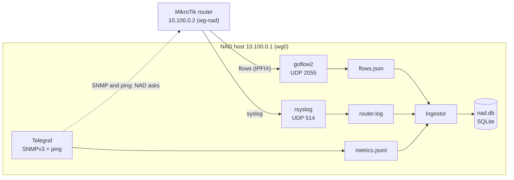
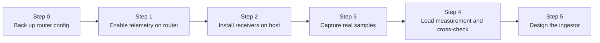

# Guide 01 — Telemetry setup and ingestion design

[Français](01-telemetry-and-ingestion.fr.md) | **English**

**Audience:** anyone reproducing the prototype, or an AI assistant picking up
the work.
**Goal:** get real telemetry flowing from the gateway router to the NAD host
through a private tunnel, then design the ingestor from real samples.
**Status:** in progress.

- Collection chain (flows, SNMP v3, syslog, probes): configured and running
  since 2026-10-21.
- Raw file rotation (`logrotate` and `cron`): in place, regular archives
  observed on 2026-10-22.
- SQLite database: created and verified on 2026-10-23.
- Ingestor: the flow reader is being written. Router load measurement and
  cross-check against the router's own counters: not done yet.

Fill in the results log (section 11) as you go. Items marked **(verify)**
depend on the RouterOS or tool version and must be checked against current
documentation.

## 1. Why this order

The order is: configure the router, prepare the host to receive, capture real
samples, cross-check them, and only then write the ingestor.

- **Parsers written from imagined formats get rewritten.** Real flow records
  have field names and quirks that are only visible once you capture some.
- **Each step has a visible result.** If something is wrong (no packets, empty
  SNMP answers), you know which link of the chain is broken.
- **The cross-check protects the whole project.** If flow data does not roughly
  match the router's own counters, every later result would be built on sand.

## 2. Mental model

The router and the NAD host are joined by a **WireGuard tunnel**. All telemetry
travels inside it, so the NAD host exposes no telemetry port to the Internet.

| Side | Role | Tunnel address | Interface |
|---|---|---|---|
| Router | Sends flows and logs, answers SNMP | 10.100.0.2 | `wg-nad` |
| NAD host (VPS) | Receives, collects, stores | 10.100.0.1 | `wg0` |



In plain words: NAD can *ask* the router questions (SNMP, ping), and the router
*sends* two kinds of messages on its own (flow summaries and event logs).

| Channel | Direction | Who starts it | Carries | Port | NAD tool |
|---|---|---|---|---|---|
| SNMP | NAD to router | NAD asks | Counters, CPU, uptime | UDP 161 | Telegraf |
| Probes | NAD to router | NAD pings | Latency, loss | ICMP | Telegraf |
| Flows (IPFIX) | Router to NAD | Router pushes | Summaries of conversations | UDP 2055 | goflow2 |
| Syslog | Router to NAD | Router pushes | Events (DHCP, Hotspot, errors) | UDP 514 | rsyslog |

What follows from this:

- Configuring the router means telling it **where to send** and **who may ask**.
- The host must be **listening before** the router starts sending. The
  receivers bind to the tunnel address, so the tunnel must be up first: the
  services are ordered after `wg-quick@wg0`.
- Flows and syslog travel over UDP: there are no retries, so packets can be lost
  silently. This is why a cross-check exists.
- The provider's firewall only sees the tunnel's own UDP port, never the
  telemetry ports inside it. Ports 2055 and 514 are therefore **not** opened on
  the public side.
- The router is only the **messenger**: every flow packet comes from the router,
  but its content describes the conversations of every user.
- Raw files grow fast (10 to 16 MB per minute for flows): an automatic
  rotation, started by `cron`, is essential (steps 2.3 and 2.6).

## 3. Prerequisites

- Access to the router (SSH or WinBox) with permission to change telemetry
  settings.
- A working WireGuard tunnel between the router and the NAD host (setting it up
  is outside this guide). Check it from the host with `sudo wg show` and
  `ping -c 3 10.100.0.2`.
- A Linux host with systemd. On the host: `tcpdump`, `jq`, `cron`, `sqlite3`,
  the Net-SNMP client tools (`snmpget`, `snmpwalk`: package `snmp` on
  Debian/Ubuntu), `rsyslog`, `goflow2` and `telegraf`, plus Python 3.9 or newer
  for the ingestor.
- Clocks synchronized by NTP on both the host and the router (step 1.4).
- The provider's firewall: only SSH and the WireGuard UDP port are open to the
  Internet, plus whatever other public services the host runs.

## 4. Workflow overview



In practice the host side comes first for each channel: the SNMP credentials
(step 2.5) before the SNMP user on the router (step 1.2), and the flow receiver
(step 2.3) before the flow export (step 1.1).

---

## 5. Step 0 — Safety net

**Why:** telemetry changes are small, but a mistake on a gateway can cut
connectivity. A backup and a way to undo make changes safe.

```
# Hardware model, RouterOS version, free storage (results log)
/system resource print

# Save the current configuration (before-nad.rsc) and check it exists
/export file=before-nad
/file print where name~"before-nad"

# FastTrack: no line under the "Flags" header means no FastTrack rule at all
/ip firewall filter print where action=fasttrack-connection

# LAN layout: bridge name, member ports (flag H = hardware offload), subnets
/interface bridge print
/interface bridge port print
/ip address print

# The tunnel to the NAD host
/interface wireguard print
/interface wireguard peers print
/ping 10.100.0.1 count=3

# Existing SNMP setup and input firewall chain
/snmp print
/snmp community print
/ip firewall filter print where chain=input
```

From your workstation, download the backup and keep it outside the repository,
then remove it from the router:

```bash
mkdir -p ~/nad-private
scp <admin-user>@<router-ip>:before-nad.rsc ~/nad-private/
```

```
/file remove before-nad.rsc
```

- **Safe mode:** `Ctrl+X` turns it on and the prompt shows `<SAFE>`. Leaving
  safe mode with `Ctrl+X` **keeps** the changes; `Ctrl+D`, or a dropped
  session, **undoes** everything done since it was turned on.
- **Do not commit the export file.** It describes the network and includes the
  router's serial number.
- **Write down** from `/ip address print`: the LAN subnet and the uplink
  addresses. The ingestor needs them (step 5).
- **About FastTrack:** on old RouterOS versions it hid traffic from flow
  export; the documentation states this restriction was removed in 6.33
  **(verify)**. No FastTrack rule exists on this router, so it is not a factor.

## 6. Step 1 — Enable telemetry on the router

Check each command with `?` or `print`, because syntax can vary between
RouterOS versions **(verify)**.

### 1.1 Flows (who talks to whom)

**Why:** flow records show conversations (source, destination, ports, bytes).
They are the richest signal for detecting scans, floods and unusual
destinations.

```
# Turn flow export on for the LAN bridge.
# active-flow-timeout: report long transfers every minute instead of only at the end
# inactive-flow-timeout: close idle flows quickly
/ip traffic-flow set enabled=yes interfaces=bridge1 active-flow-timeout=1m inactive-flow-timeout=15s

# Send flow records to the NAD host through the tunnel, IPFIX, UDP 2055.
# src-address pins the source to the tunnel address, so the host sees 10.100.0.2.
/ip traffic-flow target add dst-address=10.100.0.1 port=2055 version=ipfix src-address=10.100.0.2

# Verify
/ip traffic-flow print
/ip traffic-flow target print
```

**Observed (RouterOS 7.23.8):** exporting from the LAN bridge alone records
**both directions**, each flow once. Outbound flows carry the internal host
address (`192.168.26.x`). Inbound flows carry the router's WAN address
(`192.168.1.101`, the one of `ether1`) instead of the client address, because
the router sits behind the Starlink router (double NAT): the real client does
not appear there. Many records are single 40-byte TCP acknowledgements, so the
ingestor must aggregate by time window, never work flow by flow.

The interface indexes in flows designate the LAN (16, `bridge1`), the uplink
(1, `ether1`) and **0, which means "the router itself"**. A large share of
flows is traffic between the hosts and the router (DNS, Hotspot login, DHCP):
it does not cross the Starlink link and must not be counted as Internet
traffic (see step 3 and section 10).

If bridge ports use hardware offload, traffic between two LAN ports is switched
by the chip and never reaches the CPU, so it does not appear in flows. This is
a known limit, acceptable because most traffic goes to the Internet.

### 1.2 SNMP (counters and device health)

**Why:** SNMP gives interface throughput, CPU and uptime. It is also the
reference against which flow data is checked.

Generate the passphrases on the host first (step 2.5), then on the router:

**a) Look at what exists.** Note whether a `public` community exists and which
addresses it accepts.

```
/snmp print
/snmp community print
```

**b) Disable the default community, before enabling the service.** `public` is
the default name everyone knows, open to every address, with no encryption.

```
# Default entries usually cannot be deleted, so disable it (verify)
/snmp community disable [find name=public]

# Check: the "public" line must show an X (disabled)
/snmp community print
```

If the command is refused, restrict it instead:
`/snmp community set [find name=public] addresses=10.100.0.1/32`.

**c) Create the SNMPv3 user** (one line; `<AUTH>` and `<PRIV>` are the
passphrases generated in step 2.5):

```
/snmp community add name=nad-ro addresses=10.100.0.1/32 read-access=yes write-access=no security=private authentication-protocol=SHA1 authentication-password=<AUTH> encryption-protocol=AES encryption-password=<PRIV>
```

In RouterOS, `/snmp community` holds access profiles. With `security=private`
the entry is an **SNMPv3 user** (authenticated and encrypted), and `name`
becomes the user name. The user name and both passphrases must be identical in
this router entry and in the host's `/etc/default/telegraf` (step 2.5). Recent
RouterOS versions offer stronger algorithms than SHA1 **(verify)**; if you pick
one, change `auth_protocol` in the Telegraf configuration too.

**d) Enable the service and check:**

```
/snmp set enabled=yes
/snmp print
/snmp community print
```

`nad-ro` must be active and restricted to `10.100.0.1/32`; `public` must be
disabled.

**Observed:** the system description returned by SNMP is
`RouterOS RB1100x4 7.23.8 (long-term)`, and the router name is `MikroTikH05`.

### 1.3 Syslog (events)

**Why:** device events (DHCP, Hotspot logins, failed logins, interface changes)
are useful context. NAD uses them as counts per time window.

```
# Define a destination: the NAD host through the tunnel, UDP 514.
# syslog-time-format accepts bsd-syslog or iso8601 (verify)
/system logging action add name=nad target=remote remote=10.100.0.1 remote-port=514 src-address=10.100.0.2 syslog-facility=local0 syslog-time-format=bsd-syslog

# The action only defines WHERE to send. These rules define WHAT to send
/system logging add topics=info action=nad
/system logging add topics=warning action=nad
/system logging add topics=error action=nad
/system logging add topics=critical action=nad
/system logging add topics=firewall action=nad

# Verify
/system logging action print
/system logging print
```

Notes:

- The `firewall` topic only produces lines for firewall rules that have
  `log=yes`.
- The `info` topic is chatty: DHCP and Hotspot events dominate. These lines
  contain MAC addresses and login identifiers, which are personal data: see the
  file permissions and retention in steps 2.4 and 2.6.

### 1.4 Time

**Why:** NAD aggregates everything into one-minute windows. If the router clock
is off, its data lands in the wrong window.

```
# Time zone of the site (UTC+3, no daylight saving)
/system clock set time-zone-name=Indian/Antananarivo

# Check that the clock is right and synchronized
/system clock print
/system ntp client print
```

### 1.5 Undo

**Flows:**

```
# Remove the export target and restore the defaults (verify the default values)
/ip traffic-flow target remove [find dst-address=10.100.0.1]
/ip traffic-flow set enabled=no interfaces=all active-flow-timeout=30m inactive-flow-timeout=15s
```

**Syslog:**

```
/system logging remove [find action=nad]
/system logging action remove [find name=nad]
```

**SNMP, only if it must be removed completely:**

```
/snmp set enabled=no
/snmp community remove [find name=nad-ro]
```

Leave `public` disabled even then: it is safer than the original state.

---

## 7. Step 2 — Install the receivers on the host

**Why:** the router pushes flows and syslog without waiting. If nothing is
listening, those messages are lost. For SNMP, the host asks, so it needs the
credentials before the router user exists.

### 2.1 Packages, service user and directories

```bash
sudo apt-get update && sudo apt-get install -y rsyslog cron jq tcpdump snmp sqlite3 curl gpg

# A system user without login for the collectors' files
sudo useradd --system --no-create-home --shell /usr/sbin/nologin nad

# Raw flow files (written by goflow2, readable only by nad and root)
sudo install -d -o nad -g nad -m 750 /var/lib/nad /var/lib/nad/flows

# Router logs (written by rsyslog)
sudo install -d -o syslog -g adm /var/log/mikrotik
```

The telemetry directory for Telegraf is created in step 2.5, after the package
creates its user.

### 2.2 Network exposure

- **Provider firewall (primary filter):** open only SSH, the WireGuard UDP port
  (`sudo wg show wg0 listen-port`) and what the host serves publicly. Keep UDP
  514 and UDP 2055 **closed**: the telemetry arrives inside the tunnel, wrapped
  in WireGuard's own port.
- **Bind to the tunnel address:** each receiver listens on `10.100.0.1` only (see
  the configurations below), so even a mistaken firewall rule would not expose
  it. Check with:

```bash
sudo ss -lunp | grep -E ':(514|2055)\b'
```

- **Host firewall (optional second layer):** if `ufw` is enabled, allow only the
  router, through the tunnel, and put the SSH and WireGuard rules in place
  before enabling it:

```bash
sudo ufw allow in on wg0 from 10.100.0.2 to 10.100.0.1 port 2055 proto udp
sudo ufw allow in on wg0 from 10.100.0.2 to 10.100.0.1 port 514 proto udp
```

### 2.3 Flow receiver (goflow2)

Install goflow2 with Go, or from a release binary:

```bash
# Option A: build with Go (recent Go required)
go install github.com/netsampler/goflow2/v2/cmd/goflow2@latest
sudo install -m 755 ~/go/bin/goflow2 /usr/local/bin/goflow2

# Option B: release binary from https://github.com/netsampler/goflow2/releases
# sudo install -m 755 ./goflow2 /usr/local/bin/goflow2
```

Test in the foreground first, to see errors:

```bash
# Option names differ between versions: check with goflow2 -h (verify)
sudo goflow2 -listen "netflow://10.100.0.1:2055" -addr "127.0.0.1:9101"
```

`-addr` moves goflow2's own metrics server, which listens on port 8080 by
default; another service on the host already uses that port. A few
`template error` warnings at start are normal: IPFIX data cannot be decoded
until the router sends its template (at the next export). Then JSON lines
appear.

Install it as a service, ordered after the tunnel:

```bash
sudo tee /etc/systemd/system/goflow2.service <<'EOF'
[Unit]
Description=goflow2 IPFIX collector (NAD)
After=network-online.target wg-quick@wg0.service
Wants=network-online.target
Requires=wg-quick@wg0.service

[Service]
User=nad
ExecStart=/usr/local/bin/goflow2 -listen "netflow://10.100.0.1:2055" -addr 127.0.0.1:9101 -format json -transport file -transport.file /var/lib/nad/flows/flows.json
Restart=on-failure
RestartSec=5

[Install]
WantedBy=multi-user.target
EOF
sudo systemctl daemon-reload && sudo systemctl enable --now goflow2
systemctl status goflow2 --no-pager
```

The status must be `active (running)`. If it restarts in a loop, read the
reason with `sudo journalctl -u goflow2 -n 20 --no-pager`.

#### Raw flow rotation (mandatory)

In plain words: the raw file is a notebook that fills up at 10 to 16 MB per
minute. **Rotation** means putting the full notebook into a compressed box,
starting a fresh notebook, and throwing away the oldest boxes, so the disk never
fills up. The standard Linux tool for this is `logrotate`, and **`cron`** (the
task scheduler, an alarm clock that runs a command at regular intervals) wakes
it up every 5 minutes. Without `cron`, `logrotate` would only run once a day,
and the file would reach several tens of GB between two runs.

```bash
sudo tee /etc/logrotate.d/nad-flows <<'EOF'
/var/lib/nad/flows/flows.json {
    size 200M
    rotate 300
    compress
    copytruncate
    missingok
    notifempty
}
EOF
echo '*/5 * * * * root /usr/sbin/logrotate /etc/logrotate.d/nad-flows' | sudo tee /etc/cron.d/nad-flows
systemctl is-active cron
```

The rotation recipe, line by line:

| Line | Meaning |
|---|---|
| `/var/lib/nad/flows/flows.json {` | The file concerned |
| `size 200M` | Only archive once it exceeds 200 MB, whatever the time |
| `rotate 300` | Keep 300 archives, delete the oldest |
| `compress` | Compress the archives (gzip) |
| `copytruncate` | Copy the content, then empty the file in place |
| `missingok` | No error if the file does not exist |
| `notifempty` | Do nothing if it is empty |

The `cron` line reads: minute `*/5` (every 5 minutes), then four `*` (every
hour, every day, every month, every day of the week), the user `root`, and the
command to run. `sudo tee` creates the file with the right permissions (owned
by `root`, not writable by others). In `/etc/cron.d`, the file name may only
contain letters, digits, hyphens and underscores (no dot), otherwise `cron`
ignores it.

Things to know:

- **`copytruncate`** copies the file then empties it in place: goflow2 keeps
  writing without a restart. A few lines written during the copy can be lost,
  which is acceptable here.
- **Overshoot:** the check runs every 5 minutes, so a file can exceed 200 MB by
  a few tens of MB before being archived.
- **Numbering:** at each rotation, `flows.json.1.gz` becomes `.2.gz`, and so on.
  The higher the number, the older the archive.
- **Order of magnitude:** one archive every 15 to 45 minutes depending on
  activity, 4 to 6 MB each. With `rotate 300`, the history is two to three days
  for less than 2 GB.
- **Files outside the pattern:** `logrotate` only handles `flows.json` and its
  numbered archives. An archive made by hand under another name is never
  deleted: remove it when it is no longer needed.
- **System timer:** Debian also runs `logrotate` once a day on every file in
  `/etc/logrotate.d` **(verify)**. This has no consequence here, since the
  criterion is size.

Check:

```bash
# Dry run: writes nothing, prints the decision (many "Creating new state" lines: normal in debug mode)
sudo logrotate -d /etc/logrotate.d/nad-flows

# Did cron really run the command? (about 6 lines per half hour)
sudo journalctl -u cron --since "30 min ago" --no-pager | grep -c nad-flows

# After about 20 minutes, an archive must appear
sudo ls -lh /var/lib/nad/flows/
```

You must see `flows.json` (which starts small again) and `flows.json.1.gz`
(4 to 6 MB). If the active file is far above 200 MB, see section 12.

The directory is `750`: read these files with `sudo`. To look at an archive
without decompressing it on disk:

```bash
sudo zcat /var/lib/nad/flows/flows.json.1.gz | head -n 1 | jq .
```

### 2.4 Syslog receiver (rsyslog)

```bash
sudo tee /etc/rsyslog.d/10-mikrotik.conf <<'EOF'
# Listen for syslog on the tunnel address only
module(load="imudp")
input(type="imudp" port="514" address="10.100.0.1")

# Messages from the router go to their own file; "stop" keeps them out of the
# general system log. The file is readable by root and the adm group only.
if ($fromhost-ip == '10.100.0.2') then {
    action(type="omfile" file="/var/log/mikrotik/router.log" fileGroup="adm" fileCreateMode="0640")
    stop
}
EOF

# rsyslog binds to the tunnel address, so wg0 must be up first
sudo mkdir -p /etc/systemd/system/rsyslog.service.d
sudo tee /etc/systemd/system/rsyslog.service.d/wait-wg.conf <<'EOF'
[Unit]
After=wg-quick@wg0.service
Wants=wg-quick@wg0.service
EOF

sudo systemctl daemon-reload
sudo systemctl restart rsyslog
```

If `router.log` already existed with other permissions, fix them once:

```bash
sudo chmod 640 /var/log/mikrotik/router.log
sudo chown root:adm /var/log/mikrotik/router.log
```

Test: on the router run `/log info "test nad"`, then on the host:

```bash
sudo tail -f /var/log/mikrotik/router.log
```

#### Log rotation and retention

The file contains MAC addresses and login identifiers: keep it short-lived
(14 days here). Unlike flows, one rotation per day is enough: the system's daily
timer runs `logrotate` for this file, with no extra `cron` entry.

```bash
ls /usr/lib/rsyslog/rsyslog-rotate
sudo tee /etc/logrotate.d/mikrotik <<'EOF'
/var/log/mikrotik/router.log {
    daily
    rotate 14
    compress
    missingok
    notifempty
    postrotate
        /usr/lib/rsyslog/rsyslog-rotate
    endscript
}
EOF
sudo logrotate -d /etc/logrotate.d/mikrotik
systemctl list-timers logrotate.timer --no-pager
```

The `postrotate` block asks rsyslog to reopen its file after the rotation (so
no `copytruncate` here). If the helper script does not exist, replace this
block with `copytruncate`. The last command confirms the daily timer is
scheduled.

If the file stays empty, check that the router address in the filter matches,
that rsyslog listens on `10.100.0.1` (`ss -lunp`), and that `wg0` was up when
rsyslog started. After the first daily rotation, check that the new file keeps
the `640` permissions.

### 2.5 SNMP and probes (Telegraf)

Telegraf asks the router every 60 seconds (SNMP and ping) and writes the
answers as one JSON line per measurement.

**Install** from the vendor repository (check the commands against the current
installation page **(verify)**):

```bash
sudo mkdir -p /etc/apt/keyrings
curl -fsSL https://repos.influxdata.com/influxdata-archive.key | sudo gpg --dearmor -o /etc/apt/keyrings/influxdata-archive.gpg
echo "deb [signed-by=/etc/apt/keyrings/influxdata-archive.gpg] https://repos.influxdata.com/debian stable main" | sudo tee /etc/apt/sources.list.d/influxdata.list
sudo apt-get update && sudo apt-get install -y telegraf
telegraf --version
```

**Output directory.** Telegraf must be able to enter `/var/lib/nad` (group
`nad`) and write in its own sub-directory:

```bash
sudo usermod -aG nad telegraf
sudo install -d -o telegraf -g nad -m 755 /var/lib/nad/telemetry
id telegraf
```

A group change only applies when the service (re)starts.

**Credentials.** Generate two passphrases (Net-SNMP requires at least 8
characters) and keep them in a file only root and Telegraf can read. Never type
them directly in a command line: they would end up in the shell history and in
`ps`.

```bash
openssl rand -base64 24 | tr -d '/+=' | head -c 20; echo   # AUTH
openssl rand -base64 24 | tr -d '/+=' | head -c 20; echo   # PRIV

sudoedit /etc/default/telegraf
```

```
SNMP_USER=nad-ro
SNMP_AUTH_PASS=<AUTH>
SNMP_PRIV_PASS=<PRIV>
```

```bash
sudo chown root:telegraf /etc/default/telegraf
sudo chmod 640 /etc/default/telegraf
```

Use the same values for the router user (step 1.2 c). The Telegraf service
reads this file by itself.

**Configuration.** Start from a minimal main file (the packaged one enables many
unused plugins):

```bash
sudo mv /etc/telegraf/telegraf.conf /etc/telegraf/telegraf.conf.orig
sudo tee /etc/telegraf/telegraf.conf <<'EOF'
[agent]
  interval = "60s"
  round_interval = true
  flush_interval = "60s"
  omit_hostname = true
EOF
```

SNMP: uptime, CPU per core and interface counters. Numeric OIDs work without MIB
files. `index_as_tag = true` writes the interface number (tag `index`) next to
the name (`ifName`): this number is what flows carry (`in_if`, `out_if`), and
it is what links the two sources:

```bash
sudo tee /etc/telegraf/telegraf.d/10-snmp.conf <<'EOF'
[[inputs.snmp]]
  agents = ["udp://10.100.0.2:161"]
  version = 3
  sec_name = "${SNMP_USER}"
  sec_level = "authPriv"
  auth_protocol = "SHA"
  auth_password = "${SNMP_AUTH_PASS}"
  priv_protocol = "AES"
  priv_password = "${SNMP_PRIV_PASS}"
  timeout = "5s"
  retries = 2
  name = "router"

  [[inputs.snmp.field]]
    name = "uptime"
    oid = "1.3.6.1.2.1.1.3.0"

  [[inputs.snmp.table]]
    name = "router_cpu"
    index_as_tag = true
    [[inputs.snmp.table.field]]
      name = "cpu_load"
      oid = "1.3.6.1.2.1.25.3.3.1.2"

  [[inputs.snmp.table]]
    name = "router_if"
    index_as_tag = true
    [[inputs.snmp.table.field]]
      name = "ifName"
      oid = "1.3.6.1.2.1.31.1.1.1.1"
      is_tag = true
    [[inputs.snmp.table.field]]
      name = "in_octets"
      oid = "1.3.6.1.2.1.31.1.1.1.6"
    [[inputs.snmp.table.field]]
      name = "out_octets"
      oid = "1.3.6.1.2.1.31.1.1.1.10"
    [[inputs.snmp.table.field]]
      name = "in_errors"
      oid = "1.3.6.1.2.1.2.2.1.14"
    [[inputs.snmp.table.field]]
      name = "out_errors"
      oid = "1.3.6.1.2.1.2.2.1.20"
    [[inputs.snmp.table.field]]
      name = "oper_status"
      oid = "1.3.6.1.2.1.2.2.1.8"
EOF
```

Probe: the router, through the tunnel (the ping crosses the Starlink uplink, so
it is the most direct view of that link from the host). Internet targets would
measure the host's own connection, not the site's: probe them later from a
machine on the site's LAN.

```bash
sudo tee /etc/telegraf/telegraf.d/20-probes.conf <<'EOF'
[[inputs.ping]]
  urls = ["10.100.0.2"]
  count = 5
  ping_interval = 1.0
EOF
```

Output: one JSON line per measurement, with built-in rotation (one archive per
day, 7 kept):

```bash
sudo tee /etc/telegraf/telegraf.d/90-output.conf <<'EOF'
[[outputs.file]]
  files = ["/var/lib/nad/telemetry/metrics.jsonl"]
  data_format = "json"
  rotation_interval = "24h"
  rotation_max_archives = 7
EOF
```

**Dry run.** `--test` queries the router once and prints the result without
writing anything. It does not read `/etc/default/telegraf`, so load the
variables in the same shell:

```bash
sudo bash -c 'set -a; . /etc/default/telegraf; telegraf --test --config /etc/telegraf/telegraf.conf --config-directory /etc/telegraf/telegraf.d'
```

Expect lines starting with `ping`, `router`, `router_cpu` and `router_if`, with
`ifName=bridge1,index=16` for the LAN. A warning about `agent_host_tag` is
harmless.

**Start and check:**

```bash
sudo systemctl restart telegraf
systemctl status telegraf --no-pager
sleep 70
sudo tail -n 1 /var/lib/nad/telemetry/metrics.jsonl | jq .
```

Use `restart`, not `enable --now`, so the new group membership is applied. The
last timestamp can lag the current time (`date +%s`) by up to about 90 seconds,
because Telegraf writes once per minute. Also watch memory over a few minutes
(`ps -o rss=,etime= -C telegraf`): about 280 MB is normal on this host, and what
matters is that it stays flat.

### 2.6 Rotation and retention: overview

Every file that grows has its own rule. None may grow without limit.

| File | Rotated by | When | Kept | Why |
|---|---|---|---|---|
| `/var/lib/nad/flows/flows.json` | `logrotate`, woken by `cron` (`/etc/cron.d/nad-flows`) | Checked every 5 minutes, rotated above 200 MB | 300 compressed archives (2 to 3 days, under 2 GB) | 10 to 16 MB raw per minute |
| `/var/log/mikrotik/router.log` | `logrotate`, the system's daily timer | Once a day | 14 days | Contains MAC addresses and identifiers (personal data) |
| `/var/lib/nad/telemetry/metrics.jsonl` | Telegraf (built-in rotation) | Every 24 hours | 7 archives | Small volume |
| `/var/lib/nad/nad.db` | None | | Grows slowly (1,440 rows per day) | Windows are tiny |

How to check that everything is running:

```bash
# The scheduler is active and really runs the flow rotation
systemctl is-active cron
cat /etc/cron.d/nad-flows
sudo journalctl -u cron --since "30 min ago" --no-pager | grep -c nad-flows

# The system's daily timer is scheduled
systemctl list-timers logrotate.timer --no-pager

# Archives pile up at a regular pace, and the disk stays reasonable
sudo ls -lh /var/lib/nad/flows/ | tail -n 5
du -sh /var/lib/nad
df -h /
```

Raw flows are the only source that really weighs: the archives are a
**temporary reserve**, read by the ingestor (which also reads archives, see step
5), and the rows it stores in `nad.db` are the permanent record. If the ingestor
stays stopped for more than two to three days, the oldest archives disappear
before they have been read.

### 2.7 End-to-end check

```bash
systemctl is-active goflow2 telegraf rsyslog cron
systemctl is-enabled goflow2 telegraf rsyslog cron wg-quick@wg0
sudo ss -lunp | grep -E ':(514|2055)\b'
sudo ls -lh /var/lib/nad/flows/ | tail -n 5
sudo tail -n 200 /var/lib/nad/telemetry/metrics.jsonl | jq -r '.name' | sort | uniq -c
sudo tail -n 2 /var/log/mikrotik/router.log
df -h /
```

Expect: all services active and enabled at boot, goflow2 and rsyslog bound to
`10.100.0.1`, regular flow archives, the four measurement names (`ping`,
`router`, `router_cpu`, `router_if`), recent log lines, and a lightly used disk.
If a service was stopped, its data has a gap: note the period, because the
ingestor must treat it as missing data (step 5).

---

## 8. Step 3 — Capture real samples

**Why:** real records are what the ingestor will be designed from.

- Let the receivers run for a while during normal use of the network.
- Keep raw captures **outside Git**. Only a small anonymized excerpt belongs in
  `data/samples/`.
- Inspect one record to learn the field names, then summarize the capture:

```bash
F=/var/lib/nad/flows/flows.json

# Pretty-print the first flow record
sudo head -n 1 $F | jq .

# Split by index pair (in_if, out_if); 0 = the router itself
sudo jq -r '[.in_if,.out_if] | @tsv' $F | sort | uniq -c | sort -rn | head

# Composition of traffic from hosts to the router (protocol and destination port)
sudo jq -r 'select(.in_if==16 and .out_if==0) | "\(.proto) \(.dst_port)"' $F | sort | uniq -c | sort -rn | head

# Distinct internal hosts seen
sudo jq -r 'select(.in_if==16) | .src_addr' $F | sort -u | wc -l

# Development sample from an archive (does not touch the live file)
mkdir -p ~/nad-samples
sudo zcat /var/lib/nad/flows/flows.json.1.gz | head -n 50000 > ~/nad-samples/flows-sample.jsonl
chmod 600 ~/nad-samples/flows-sample.jsonl
```

**Observed on an active file of 142,956 flows (proportions vary with
activity):**

| Pair (`in_if` to `out_if`) | Count | Meaning |
|---|---|---|
| 16 to 1 | 25,191 | Outbound: LAN host to the Internet |
| 1 to 16 | 24,398 | Inbound: Internet to LAN host |
| 16 to 0 | 44,176 | LAN host to the router itself |
| 0 to 16 | 49,188 | The router answers a LAN host |
| 16 to 16 | 2 | Between two LAN hosts |
| 16 to another bridge | 1 | To a separate network, out of scope |

Traffic to the router is therefore very large (here two thirds of flows). On a
sample of 100,000 lines, its composition was: TCP 443 (2,900), UDP 53 (1,574),
TCP 80 (157), TCP 8080 (34), TCP 64875 and 64874 (27, MikroTik Hotspot ports
**(verify)**), UDP 67 (16, DHCP), UDP 5678 (8, MikroTik neighbor discovery),
ICMP and TCP 53 (7). These are the router's own services (DNS, Hotspot, DHCP):
this traffic mostly reflects users arriving, and a sudden surge would be a
useful signal for detection.

**Volume:** each raw JSON line is about 1 KB, most of it unused fields (BGP,
MPLS, IPv6). On this network that is **10 to 16 MB per minute depending on
activity**, in the order of 15 to 23 GB of raw JSON per day. Gzip shrinks it by
a factor of 30 to 40 (about 200 MB become 4 to 6 MB), hence the rotation in
step 2.3 and the field selection in the ingestor.

A test session validates the **pipeline**, not the baseline. The baseline is
built later from continuous collection.

## 9. Step 4 — Load measurement and cross-check

Both measurements use the files Telegraf already writes, so no passphrase is
typed in a command.

### 4.1 Router load (phases A/B/C)

**Why:** flow export costs CPU on a gateway that serves the whole company. One
reading is not enough: the load varies with usage. Three phases of 10 minutes
each, measured the same way, separate the cost of the export from the natural
variation:

| Phase | Flow export | Purpose |
|---|---|---|
| A | Off | Reference load |
| B | On | Load with export |
| C | Off again | Checks that the load returns to the reference (control) |

Toggle with `/ip traffic-flow set enabled=no` and `enabled=yes`. Avoid large
downloads during the measurement, and run all three phases in a row, at a
similar time of day. Note the start and end of each phase as a Unix time
(`date -u +%s` on the host), then compute per phase (Telegraf writes one
reading per core per minute):

```bash
S=<start-epoch>; E=<end-epoch>
sudo jq -r --argjson s $S --argjson e $E \
  'select(.name=="router_cpu" and .timestamp>=$s and .timestamp<$e) | [.timestamp, .fields.cpu_load] | @tsv' \
  /var/lib/nad/telemetry/metrics.jsonl \
  | awk '{c+=$2; if ($2>m) m=$2; n++} END {printf "readings=%d cpu_mean=%.1f core_max=%d\n", n, c/n, m}'
```

The busiest core matters: one core can saturate before the average looks high.
Router memory is not collected yet (adding the storage table is planned,
section 13).

### 4.2 Cross-check flows against SNMP

**Why:** flow export can undercount (hardware offload) or overcount (the same
traffic exported from several interfaces), and UDP can drop packets. SNMP
counters come from the interface itself and serve as the reference.
**Not tested yet.**

Use the LAN bridge only: its two counters cover both directions, and unlike the
uplink they exclude tunnel encapsulation and traffic dropped by the firewall.

| SNMP counter on the LAN bridge | Matches flows with | What it covers |
|---|---|---|
| `in_octets` | `in_if` = LAN index, **all classes** | Everything the LAN sends: to the Internet **and** to the router |
| `out_octets` | `out_if` = LAN index, **all classes** | Everything the router delivers to the LAN: from the Internet **and** its own replies |

The cross-check therefore compares the counters with **all** flows that enter or
leave through the LAN. This is not the same thing as the "up" and "down"
columns of the database (section 10), which exclude traffic to the router.

First find the LAN bridge index, which Telegraf now writes itself:

```bash
sudo jq -r 'select(.name=="router_if" and .tags.ifName=="bridge1") | .tags.index' /var/lib/nad/telemetry/metrics.jsonl | tail -n 1
```

Then compare two consecutive Telegraf readings of `bridge1` with the flows that
ended in the same interval:

```bash
B=<lan-ifindex>

# Counters: take two timestamps about 5 minutes apart and subtract
sudo jq -r 'select(.name=="router_if" and .tags.ifName=="bridge1") | [.timestamp,.fields.in_octets,.fields.out_octets] | @tsv' \
  /var/lib/nad/telemetry/metrics.jsonl | tail -n 8

# Flows: bytes per direction between the same two timestamps
T1=<first-timestamp>; T2=<second-timestamp>
sudo jq -r --argjson b $B --argjson s $T1 --argjson e $T2 \
  'select((.time_flow_end_ns/1e9)>=$s and (.time_flow_end_ns/1e9)<$e)
   | [(if .in_if==$b then "lan_sends" elif .out_if==$b then "lan_receives" else "other" end), .bytes] | @tsv' \
  /var/lib/nad/flows/flows.json | awk '{a[$1]+=$2} END {for (k in a) print k, a[k]}'
```

Compare each counter difference with the matching total. Expect rough
agreement, not equality: the bridge counters also include Ethernet framing,
which flows do not count, and the SNMP polling itself. A large gap points to
one of the causes in section 12.

## 10. Step 5 — Design the ingestor

### Concept

In plain words, the ingestor is a sorting center. It reads the raw files, drops
each event into the box for its minute, counts what is in each box, and writes
one row per box.

Four stages, each independent so a source can be swapped without touching the
rest:

1. **Read:** one adapter per source (flows, Telegraf measurements, logs).
2. **Normalize:** convert each event to a common internal form (UTC timestamp,
   direction, bytes, addresses).
3. **Aggregate:** assign events to one-minute windows and compute the features.
4. **Write:** store one row per window in the database.

### Design decisions

| Decision | Why |
|---|---|
| All timestamps in UTC, one-minute windows aligned to the minute; the weekly baseline is computed in the site's time zone (`Indian/Antananarivo`, UTC+3, no daylight saving) | Users follow their own clock; the host's time zone and its daylight-saving change must never matter |
| Store one-minute windows, detect on five-minute windows built from five rows | One-minute rows can always be grouped, never the reverse; five minutes smooth the spikes on a small network |
| Close a window only after a delay | Flow records arrive late (router timeouts); closing instantly would undercount |
| Idempotent writes (upsert on the window key), each source touching only its own columns | Re-running the ingestor must never duplicate rows; the three sources arrive at different times and must not overwrite each other |
| Remember the read position per file, and read rotated archives too | Files rotate every 15 to 45 minutes; a stop must not skip or repeat data |
| A source with no data leaves its columns NULL and its `has_*` flag at 0, never zero | A stopped service creates a gap that must not look like a silent network; NULL means "unknown" |
| SNMP counters are cumulative: use the difference between consecutive readings, and drop negative differences | Counters restart at zero when the router reboots |
| Flow class from the **pair** (`in_if`, `out_if`): LAN to WAN is up, WAN to LAN is down, LAN to 0 and 0 to LAN are traffic with the router itself, any other pair is `other` | Index 0 is the router itself (DNS, Hotspot, DHCP); counting it as upload would inflate Internet traffic by more than half |
| Interface indexes resolved from names at startup (Telegraf writes `ifName` and `index`) | Indexes can change when interfaces appear or disappear |
| Per-host features use LAN to WAN flows; `distinct_hosts` uses every flow that enters from the LAN | Inbound flows carry the router's WAN address, not the client; a host that only queries DNS is still active |
| Address classes as configuration: internal (LAN), upstream (Starlink router LAN), management tunnel | Upstream and management traffic are neither internal users nor the Internet |
| Keep only the needed fields at read time, and count unusable lines without crashing | Raw records are ~1 KB, mostly unused fields; the last line of a live file can be cut off |
| Assign a flow to the window of its end time | Simple and deterministic; with a 1-minute active timeout, a flow never spans more than two windows |
| `STRICT` tables, with CHECK constraints on alignment, flags and counter differences | An ingestor bug fails loudly instead of storing a wrong value |

Fields used from goflow2: `time_flow_end_ns`, `in_if`, `out_if`, `bytes`,
`packets`, `src_addr`, `dst_addr`, `dst_port` (the others, such as `src_port`,
`proto` or `tcp_flags`, remain available for later features). Timestamps are in
nanoseconds.

Telegraf measurements used: `router_if` (tags `ifName` and `index`; fields
`in_octets`, `out_octets`, `in_errors`, `out_errors`, `oper_status`),
`router_cpu` (tag `index`; field `cpu_load`), `router` (`uptime`) and `ping`
(`average_response_ms`, `maximum_response_ms`, `packets_transmitted`,
`packets_received`, `result_code`). Timestamps are Unix seconds.

Example configuration (values from the reference network):

```yaml
internal_subnets:
  - 192.168.26.0/24   # LAN users
upstream_subnets:
  - 192.168.1.0/24    # Starlink router LAN (neither internal nor Internet)
management_subnets:
  - 10.100.0.0/24     # WireGuard tunnel between the router and the NAD host
lan_interface: bridge1   # index 16 (resolve at startup)
wan_interface: ether1    # index 1 (resolve at startup)
router_index: 0          # "the router itself" in flows
ignored_interfaces:
  - bridge2              # separate network for a specific use, out of scope
timezone: Indian/Antananarivo
```

### Storage: the SQLite database

In plain words: the database is one file that works like a spreadsheet. Each
row is one minute of network life, each column is one summary of that minute.
The flow, SNMP and log readers write into the same row at different moments,
each one filling only its own columns.

**Install the tools.** The `sqlite3` command-line client creates and inspects
the file; Python already ships its own `sqlite3` module.

```bash
sudo apt-get install -y sqlite3
sqlite3 --version
python3 -c "import sqlite3; print(sqlite3.sqlite_version)"
```

Both versions must be 3.37 or newer (`STRICT` tables need it; the upsert syntax
used by the ingestor needs 3.24). If one is older, remove `STRICT` from the
statements below.

**Create the database** as the service user, so it owns the file. The `PRAGMA
journal_mode = WAL` setting is stored in the file: readers and the writer no
longer block each other.

```bash
sudo -u nad sqlite3 /var/lib/nad/nad.db <<'EOF'
PRAGMA journal_mode = WAL;
PRAGMA user_version = 1;

-- One row per one-minute window (UTC, aligned to the minute).
-- Flows are classified by the pair (in_if, out_if): LAN = bridge1, WAN = ether1,
-- index 0 = the router itself. Each flow lands in exactly one class.
-- A source with no data for the window leaves its columns NULL and its has_* flag at 0.
CREATE TABLE IF NOT EXISTS windows (
  window_start       INTEGER PRIMARY KEY CHECK (window_start % 60 = 0),

  -- from flows
  flows_up           INTEGER,   -- LAN -> WAN (upload)
  bytes_up           INTEGER,
  packets_up         INTEGER,
  flows_down         INTEGER,   -- WAN -> LAN (download)
  bytes_down         INTEGER,
  packets_down       INTEGER,
  flows_to_router    INTEGER,   -- LAN -> router itself (DNS, Hotspot, DHCP)
  bytes_to_router    INTEGER,
  flows_from_router  INTEGER,   -- router itself -> LAN
  bytes_from_router  INTEGER,
  flows_other        INTEGER,   -- any other pair
  distinct_hosts     INTEGER,   -- LAN hosts seen as flow source (all flows entering from the LAN)
  distinct_dests     INTEGER,   -- from LAN -> WAN flows
  distinct_ports     INTEGER,   -- destination ports of LAN -> WAN flows
  top_talker_share   REAL,      -- busiest host's share of bytes_up, between 0 and 1

  -- from SNMP
  cpu_pct            REAL,      -- mean of the cores
  cpu_core_max_pct   REAL,      -- busiest core
  lan_in_bytes       INTEGER CHECK (lan_in_bytes IS NULL OR lan_in_bytes >= 0),   -- bridge1 counter difference
  lan_out_bytes      INTEGER CHECK (lan_out_bytes IS NULL OR lan_out_bytes >= 0),

  -- from router logs
  log_events         INTEGER,

  -- which sources had data for this window
  has_flows          INTEGER NOT NULL DEFAULT 0 CHECK (has_flows IN (0, 1)),
  has_snmp           INTEGER NOT NULL DEFAULT 0 CHECK (has_snmp IN (0, 1)),
  has_logs           INTEGER NOT NULL DEFAULT 0 CHECK (has_logs IN (0, 1)),
  ingested_at        INTEGER NOT NULL
) STRICT;

-- One row per window and probe target
CREATE TABLE IF NOT EXISTS probe_windows (
  window_start    INTEGER NOT NULL CHECK (window_start % 60 = 0),
  target          TEXT NOT NULL,
  rtt_mean_ms     REAL,
  rtt_max_ms      REAL,
  pings_sent      INTEGER,
  pings_received  INTEGER,
  PRIMARY KEY (window_start, target)
) STRICT;

-- Where the ingestor stopped in each input file, to resume without duplicates
CREATE TABLE IF NOT EXISTS file_offsets (
  path         TEXT PRIMARY KEY,
  inode        INTEGER,
  byte_offset  INTEGER NOT NULL,
  updated_at   INTEGER NOT NULL
) STRICT;
EOF
```

Probes live in their own table because each window has one row per target.
Probing both the tunnel and, later, Internet targets from the site tells a local
link problem apart from a satellite link problem. There is no latency
percentile: Telegraf does not record each ping, only the summary of the minute
(mean, maximum, number of replies), so a 95th percentile would be meaningless.

**Check it:**

```bash
sudo -u nad sqlite3 /var/lib/nad/nad.db '.tables' 'PRAGMA journal_mode;' 'PRAGMA user_version;'
sudo -u nad sqlite3 /var/lib/nad/nad.db '.schema probe_windows'
sudo ls -l /var/lib/nad/
```

Expect the three tables, `wal`, `1`, and a `nad.db` file owned by `nad`. A
`nad.db-wal` and a `nad.db-shm` file appear next to it while a program has the
database open: that is normal.

**Smoke test** (nothing is kept: it ends with `ROLLBACK`). It checks the upsert
and the constraints:

```bash
sudo -u nad sqlite3 /var/lib/nad/nad.db <<'EOF'
BEGIN;
INSERT INTO windows (window_start, bytes_up, has_flows, ingested_at)
  VALUES (1792700040, 1000, 1, 1792700100);
INSERT INTO windows (window_start, bytes_up, has_flows, ingested_at)
  VALUES (1792700040, 2000, 1, 1792700101)
  ON CONFLICT(window_start) DO UPDATE SET bytes_up = excluded.bytes_up;
SELECT window_start, bytes_up FROM windows;
INSERT INTO windows (window_start, ingested_at) VALUES (1792700041, 1792700100);
ROLLBACK;
SELECT count(*) FROM windows;
EOF
```

Expect `1792700040|2000` (one row, updated, not duplicated), then a `CHECK
constraint failed` error for the window that is not aligned to the minute, then
`0`.

**Rules for every program that uses the database:**

- Run the ingestor, the detector and the dashboard as the user `nad`. In WAL
  mode even a reader writes to the `-shm` file, so a reader without write
  access to the directory fails.
- At each connection, set `PRAGMA busy_timeout = 5000;` and `PRAGMA
  synchronous = NORMAL;` (these two are per connection, unlike the journal
  mode).
- Never copy `nad.db` while the ingestor runs. Use
  `sqlite3 /var/lib/nad/nad.db ".backup '/path/to/copy.db'"`.
- Each source updates only its own columns and its own `has_*` flag, with an
  upsert on `window_start`, so the three sources can fill the same row without
  overwriting each other.
- When a source has data for a window (`has_*` = 1), every column of that
  source is a number, with 0 when nothing happened, never NULL. NULL means
  "unknown".
- `has_flows` is set when at least one flow record ended in the window, and
  `has_snmp` when a Telegraf reading covered it. `has_logs` is set when at
  least one log line arrived; a window with no log line at all is rare on this
  network (DHCP and Hotspot are chatty) and counts as missing.

**From one-minute rows to five-minute windows.** The detector (Python,
`pandas`) builds the five-minute windows from five stored rows:

| Columns | Combination over five minutes |
|---|---|
| Flow counts, bytes, packets, `log_events`, `lan_in_bytes`, `lan_out_bytes`, `pings_sent`, `pings_received` | Sum |
| `cpu_pct`, `rtt_mean_ms` | Mean |
| `cpu_core_max_pct`, `rtt_max_ms`, `top_talker_share` | Maximum |
| `distinct_hosts`, `distinct_dests`, `distinct_ports` | Maximum of the five rows (a sum would count a host twice if it is active in two minutes); recompute from the raw flows if exactness is needed |

Packet loss over five minutes is
`1 - sum(pings_received) / sum(pings_sent)`, exact because both counts are
stored. A five-minute window is only used when enough of its five rows have data
(rule to define in the detector).

## 11. Results log

Fill this in after each session. These values feed the decisions in
`docs/tools/tooling.md`.

| Item | Value |
|---|---|
| Router model and RouterOS version | RB1100x4, RouterOS 7.23.8 (long-term), name `MikroTikH05` (from SNMP) |
| Router time zone | `Indian/Antananarivo`, UTC+3, no daylight saving |
| NAD host | VPS with 8 GB RAM, systemd, time zone Europe/Paris (CEST), NTP synchronized |
| Tunnel | WireGuard, router 10.100.0.2 (`wg-nad`) to host 10.100.0.1 (`wg0`); ping through it about 211 ms mean, 0 % loss |
| FastTrack enabled | No (no rule configured) |
| LAN | `bridge1`, 192.168.26.0/24, router 192.168.26.1; DHCP server and Hotspot active |
| Uplink | `ether1`, 192.168.1.101/24 assigned by the Starlink router (double NAT) |
| Other network | `bridge2` (192.168.20.0/24): separate network for a specific use, out of scope, not exported in flows |
| Interface indexes (SNMP) | `ether1` to `ether13` = 1 to 13, `lo` = 15, `bridge1` = 16, `bridge2` = 17, `wg-nad` = 18; index 14 does not appear (unassigned) |
| Flow export | IPFIX from `bridge1` only, timeouts 1 m / 15 s; in flows, 16 = `bridge1`, 1 = `ether1`, 0 = the router itself |
| Index pairs in flows | 16 to 1 and 1 to 16: about 35 % together; 16 to 0 and 0 to 16: about 65 % together (active file of 142,956 flows) |
| Traffic to the router | Mostly TCP 443, UDP 53 (DNS), TCP 80, Hotspot ports, UDP 67 (DHCP) |
| Addresses in flows | Outbound: internal hosts (192.168.26.x). Inbound: router WAN address (192.168.1.101) |
| Raw flow volume | About 1 KB per line, 10 to 16 MB per minute depending on activity (15 to 23 GB per day); gzip 30 to 40 times smaller |
| Flow rotation | `logrotate` (200 MB, 300 archives) woken by `cron` every 5 minutes; archives of 4 to 6 MB, one every 15 to 45 minutes depending on activity |
| Disk | 4.9 GB used of 147 GB on 2026-10-22 |
| Telegraf | Version 1.40.2, 60 s interval, about 280 MB of RAM, stable; `index` tag active on interfaces |
| Tunnel counters | `wg-nad`: 988 output errors on 2026-10-21 at 18:05, 1,704 on 2026-10-22 at 23:34 (716 more in about 29.5 h, for about 267 MB sent); to watch |
| SQLite database | `/var/lib/nad/nad.db`, WAL mode, `user_version` 1, three tables, upsert and constraint smoke test passed (2026-10-23) |
| Syslog format observed | `<time with offset> <router tunnel address> <topics> <message>`, time stamped on reception in the host's local zone **(verify)** |
| Router load, export off versus on | Not measured yet |
| Flows versus SNMP counters (ratio) | Not measured yet |
| Notes | Double NAT behind the Starlink router; the `info` topic is dominated by DHCP and Hotspot events |

## 12. Troubleshooting

### Flows

| Symptom | Likely cause | What to check |
|---|---|---|
| No packets in `tcpdump -ni wg0 udp port 2055` | Router not exporting, tunnel down, wrong target address | `/ip traffic-flow target print`; `ping 10.100.0.2`; `sudo wg show` |
| goflow2 exits at start with "address already in use" | Its metrics port (8080 by default) is taken | `sudo ss -tlnp \| grep 8080`; start with `-addr 127.0.0.1:9101` |
| goflow2 restarts in a loop under systemd | Output directory missing or not writable by `nad` | `sudo journalctl -u goflow2 -n 20`; `ls -ld /var/lib/nad/flows` |
| `template error` warnings in goflow2 | Template not received yet | Normal for the first seconds; investigate if it lasts more than 2 minutes |
| Flow file does not grow | Service stopped, or router not exporting | `systemctl is-active goflow2`; `tcpdump` on `wg0` |
| Flow bytes much lower than SNMP | Hardware offload, packet loss | Bridge port flags, UDP drops on the host |
| Flow bytes higher than SNMP | Same traffic exported from several interfaces | Export interface choice (`bridge1` versus `all`) |
| Router CPU rises noticeably | Flow export load | Phases A/B/C (step 4.1); adjust timeouts or enable sampling |

### Rotation, cron and disk

| Symptom | Likely cause | What to check |
|---|---|---|
| Flow file far above 200 MB | `cron` inactive, or `/etc/cron.d/nad-flows` ignored | `systemctl is-active cron`; `cat /etc/cron.d/nad-flows` (owned by `root`, one line ending with a newline, name without a dot); `sudo journalctl -u cron --since "30 min ago" \| grep nad-flows` |
| `cron` runs the command, but no archive appears | File under the size threshold, or `logrotate` error | `sudo logrotate -d /etc/logrotate.d/nad-flows`; error messages on screen |
| No `router.log` archive after several days | System timer missing or inactive | `systemctl list-timers logrotate.timer`; `sudo logrotate -d /etc/logrotate.d/mikrotik` |
| The disk fills up | Rotation inactive, retention too long, or a forgotten manual archive | `du -sh /var/lib/nad/*`; `sudo ls -lh /var/lib/nad/flows/`; lower `rotate` if needed |
| `router.log` becomes world-readable after rotation | The new file is created without `fileCreateMode` | Check `10-mikrotik.conf` (`fileCreateMode="0640"`) and restart rsyslog |
| `metrics.jsonl` grows without limit | `rotation_interval` missing in `90-output.conf` | `cat /etc/telegraf/telegraf.d/90-output.conf`; restart Telegraf |

### SNMP and probes

| Symptom | Likely cause | What to check |
|---|---|---|
| `request timeout` in Telegraf | Service disabled, `addresses=` not `10.100.0.1/32`, `input` firewall rule, or router entry and `/etc/default/telegraf` not matching (user name included) | `/snmp print`; `/snmp community print detail`; `/ip firewall filter print where chain=input`; `tcpdump -ni wg0 udp port 161` |
| `Authentication failure` | Different passphrase or algorithm (SHA1 versus another) | Same value and algorithm on both sides |
| `Decryption error` | Different `PRIV` passphrase or cipher | Same value on both sides |
| `No Such Object available` | OID not exposed by the router | `snmpwalk` the parent branch |
| `permission denied` on `metrics.jsonl` | Group change not applied, or directory missing | `id telegraf`; `ls -ld /var/lib/nad/telemetry`; restart the service |
| Measurements stop | Telegraf stopped | `systemctl status telegraf`; compare the last timestamp with `date +%s` |
| Counters only go up | Normal: counters are cumulative | Use differences between readings |
| Ping missing | ICMP not allowed for the service | `which ping`; `journalctl -u telegraf` |

### Syslog, time and exposure

| Symptom | Likely cause | What to check |
|---|---|---|
| `router.log` empty | rsyslog not bound to the tunnel, tunnel down at start, wrong filter address, permissions | `sudo ss -lunp \| grep 514`; `wait-wg.conf`; `fromhost-ip` value; `/var/log/mikrotik` ownership |
| No firewall lines | Rules without `log=yes` | Enable logging on the rules to observe |
| Windows misaligned between sources | Router clock not synchronized | `/system clock print`; `/system ntp client print` |
| Local-time log lines repeat an hour | Daylight-saving change on the host | Parse timestamps with their offset, or use Unix times |
| A telemetry port is reachable from the Internet | Rule opened at the provider, receiver bound to all addresses | Provider firewall rules; `ss -lunp` must show `10.100.0.1` only |
| Configuration gone after closing SSH | Session closed while still in safe mode | Expected for tests; `Ctrl+X` keeps changes |

### Database

| Symptom | Likely cause | What to check |
|---|---|---|
| `database is locked` | Two writers at once without a wait delay | `PRAGMA busy_timeout = 5000;` at each connection; one writer at a time |
| `attempt to write a readonly database` | Program run as a user other than `nad`, or directory permissions | `ls -ld /var/lib/nad`; run with `sudo -u nad` |
| Error at creation on `STRICT` | SQLite version too old (before 3.37) | `sqlite3 --version`; remove `STRICT` if needed |
| `CHECK constraint failed` | Window not aligned to the minute, flag outside 0 or 1, negative counter difference | Values sent by the ingestor; counter reset by a router reboot |
| `nad.db-wal` and `nad.db-shm` files left over | Program stopped abruptly | Normal; SQLite picks them up at the next open; do not delete them by hand |

## 13. Next steps

1. Validate the flow reader (`src/nad/collect/flows.py`) on the sample: tests,
   then the per-minute summary.
2. Write the windows into `nad.db` (upsert) and remember the read position in
   `file_offsets`, reading the numbered archives too.
3. Telegraf measurement reader: counter differences, CPU, ping.
4. Count log lines per minute.
5. Resolve interface indexes from names at startup, instead of the hard-coded
   values.
6. Router load, phases A/B/C (step 4.1), and add the storage table to collect
   router memory.
7. Cross-check flows against the LAN bridge counters (step 4.2).
8. After the first daily rotation, check the permissions and retention of
   `router.log`.
9. Probe Internet targets from a machine on the site's LAN, to complement the
   tunnel probe.
10. Build the five-minute windows and the first detector.
11. Ansible roles that install and configure the receivers on the NAD host
    (goflow2, rsyslog, Telegraf, `logrotate`, `cron`, systemd units).

Later hardening, outside this guide: a static firewall rule on the router that
only accepts UDP 161 from `10.100.0.1`. The router runs a Hotspot, and changing a
production gateway's firewall is a separate project.

## Glossary

- **Flow:** a summary of one conversation between two machines (addresses,
  ports, bytes, packets).
- **IPFIX:** the standard flow export format (a successor of NetFlow v9).
- **SNMP:** a standard protocol to ask a device for its counters and status.
- **Community (SNMP v1/v2c):** a shared password sent in clear text with every
  request. `public` is the universal default.
- **SNMPv3 user:** an account with authentication and, at `authPriv` level,
  encryption. In RouterOS it is an entry of `/snmp community` with
  `security=private`.
- **OID:** the numeric address of a value in SNMP, such as
  `1.3.6.1.2.1.1.3.0` for the uptime.
- **MIB:** a catalogue that gives names to OIDs. Numeric OIDs work without it.
- **ifIndex:** the number SNMP and flow records use to identify an interface.
  Index 0, in flows, designates the router itself.
- **Cumulative counter:** a value that only grows since the router started;
  traffic in a period is the difference between two readings.
- **Syslog:** a standard protocol for devices to send event messages.
- **WireGuard tunnel:** an encrypted private link between the router and the NAD
  host; everything inside it uses private addresses.
- **Log rotation:** archiving and compressing a growing file, then starting a
  new one, so the disk never fills.
- **logrotate:** the standard Linux tool that performs rotation from a recipe
  (size, number of archives, compression).
- **cron:** the Linux task scheduler, an alarm clock that runs a command at
  regular intervals. A file in `/etc/cron.d` holds one line per task: five time
  fields, the user, the command.
- **Window:** a fixed slice of time (one minute) into which all events are
  grouped.
- **Flow class:** the kind of traffic of a flow, deduced from the index pair
  (up, down, to the router, from the router, other).
- **SQLite:** a database that fits in a single file, with no server.
- **WAL:** a SQLite journal mode where readers and the writer do not block each
  other.
- **Upsert:** insert a row, or update it if it already exists.
- **Idempotent:** running an operation twice gives the same result as running
  it once.
- **FastTrack:** a MikroTik feature that speeds up forwarding by bypassing part
  of the packet processing.
- **NAT:** the router replaces internal addresses with its own before sending
  traffic out. Behind the Starlink router there are two NAT layers (double NAT).
- **Bridge:** a virtual switch grouping several ports into one LAN interface.
- **Hardware offload:** traffic switched by the chip without reaching the CPU; it
  does not appear in flow export.
- **Hotspot:** a MikroTik feature for guest access with a login page; it adds
  dynamic firewall rules.
- **Template (IPFIX/NetFlow v9):** a message describing the field layout; data
  records cannot be decoded before it arrives.
- **Safe mode:** a RouterOS session mode where changes are undone unless you
  explicitly keep them.

## Appendix — Files and paths used

Everything is on the NAD host unless stated otherwise. Permissions are those
expected after following this guide.

### Data and logs

| Path | Content | Owner and permissions | Written by |
|---|---|---|---|
| `/var/lib/nad/` | Root directory of NAD data | `nad:nad`, 750 | Step 2.1 |
| `/var/lib/nad/flows/flows.json` | Flows being written (JSON, one line per flow) | `nad:nad` | goflow2 |
| `/var/lib/nad/flows/flows.json.N.gz` | Rotation archives (the higher N, the older) | `nad:nad` | `logrotate` |
| `/var/lib/nad/telemetry/metrics.jsonl` | SNMP and ping measurements (one JSON line per measurement), rotation archives in the same directory | `telegraf:nad`, directory 755 | Telegraf |
| `/var/lib/nad/nad.db` | SQLite database (WAL mode); `nad.db-wal` and `nad.db-shm` appear next to it while a program has it open | `nad:nad` | Ingestor |
| `/var/log/mikrotik/router.log` | Router logs, archives `.1.gz` to `.14.gz` | `root:adm`, 640 | rsyslog |
| `~/nad-samples/flows-sample.jsonl` | Development sample taken from an archive, **outside Git** | Your user, 600 | By hand (step 3) |
| `~/nad-private/before-nad.rsc` | Router configuration backup, **outside Git**, on your workstation | Your user | By hand (step 0) |

### Configuration

| Path | Role | Step |
|---|---|---|
| `/etc/systemd/system/goflow2.service` | goflow2 service, starts after the tunnel | 2.3 |
| `/usr/local/bin/goflow2` | goflow2 binary | 2.3 |
| `/etc/logrotate.d/nad-flows` | Flow rotation recipe (200 MB, 300 archives) | 2.3 |
| `/etc/cron.d/nad-flows` | Wakes `logrotate` every 5 minutes for flows | 2.3 |
| `/etc/rsyslog.d/10-mikrotik.conf` | Syslog reception on the tunnel address and filter to `router.log` | 2.4 |
| `/etc/systemd/system/rsyslog.service.d/wait-wg.conf` | rsyslog waits for the tunnel before starting | 2.4 |
| `/etc/logrotate.d/mikrotik` | Daily rotation of `router.log` (14 days) | 2.4 |
| `/etc/telegraf/telegraf.conf` | General Telegraf settings (60 s interval); the original is in `telegraf.conf.orig` | 2.5 |
| `/etc/telegraf/telegraf.d/10-snmp.conf` | SNMPv3 collection (uptime, CPU, interfaces) | 2.5 |
| `/etc/telegraf/telegraf.d/20-probes.conf` | Ping to the router | 2.5 |
| `/etc/telegraf/telegraf.d/90-output.conf` | Output to `metrics.jsonl`, built-in rotation (24 h, 7 archives) | 2.5 |
| `/etc/default/telegraf` | **SNMP credentials**: `root:telegraf`, 640. Never goes into Git, never typed in a command | 2.5 |
| `/etc/wireguard/wg0.conf` (likely) | WireGuard tunnel, outside this guide | Prerequisite |

### Provided by the system

| Path | Role |
|---|---|
| `/usr/lib/systemd/system/telegraf.service` | Telegraf service, installed by the package |
| `/usr/lib/rsyslog/rsyslog-rotate` | Script that asks rsyslog to reopen its file after rotation |
| `/var/lib/logrotate/status` | `logrotate`'s memory: date of the last rotation of each file |

### In the repository

| Path | Role |
|---|---|
| `src/nad/collect/flows.py` | Flow reader: one-minute windows, traffic classes |
| `tests/test_flows.py` | Tests of the flow reader |
| `docs/guides/01-telemetry-and-ingestion.md` and `.fr.md` | This guide |
| `docs/tools/tooling.md` and `.fr.md` | Tool comparison and decisions |
| `docs/diagrams/` | Architecture diagrams (`.puml` sources and `.png` images) |

### Quick check

```bash
sudo ls -ld /var/lib/nad /var/lib/nad/flows /var/lib/nad/telemetry /var/log/mikrotik
sudo ls -l /var/lib/nad/nad.db /var/log/mikrotik/router.log /var/lib/nad/telemetry/metrics.jsonl
sudo ls -l /etc/systemd/system/goflow2.service /etc/systemd/system/rsyslog.service.d/wait-wg.conf
sudo ls -l /etc/rsyslog.d/10-mikrotik.conf /etc/logrotate.d/nad-flows /etc/logrotate.d/mikrotik /etc/cron.d/nad-flows
sudo ls -l /etc/telegraf/telegraf.conf /etc/telegraf/telegraf.d/ /etc/default/telegraf
```

An `ls` command that answers "No such file or directory" points to a step to
redo or a file name that differs from the one in the guide.
