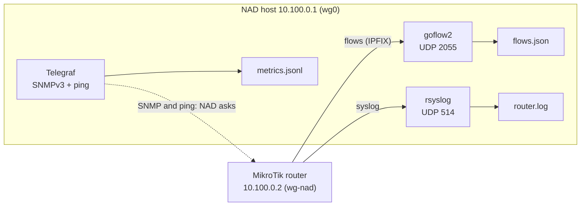
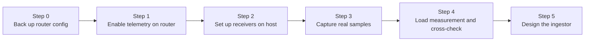

# Guide 01 — Telemetry setup and ingestion design

[Français](01-telemetry-and-ingestion.fr.md) | **English**

**Audience:** anyone reproducing the prototype, or an AI assistant picking up
the work.
**Goal:** get real telemetry flowing from the gateway router to the NAD host
through a private tunnel, then design the ingestor from real samples.
**Status:** in progress.

- Collection chain (flows, SNMP v3, syslog, probes): configured and running
  since 2026-10-21.
- Router load measurement, cross-check against the router's own counters, and
  the ingestor: not done yet.

Fill in the results log (section 11) as you go. Items marked **(verify)**
depend on the RouterOS or tool version and must be checked against current
documentation.

## 1. Why this order

The order is: configure the router, prepare the host to receive, capture real
samples, cross-check them, and only then write the ingestor.

- **Parsers written from imagined formats get rewritten.** Real flow records
  have field names and quirks that are only visible once you capture some.
- **Each step has a visible result.** If something is wrong (no packets, empty
  SNMP answers), you know which link of the chain is broken.
- **The cross-check protects the whole project.** If flow data does not roughly
  match the router's own counters, every later result would be built on sand.

## 2. Mental model

The router and the NAD host are joined by a **WireGuard tunnel**. All telemetry
travels inside it, so the NAD host exposes no telemetry port to the Internet.

| Side | Role | Tunnel address | Interface |
|---|---|---|---|
| Router | Sends flows and logs, answers SNMP | 10.100.0.2 | `wg-nad` |
| NAD host (VPS) | Receives, collects, stores | 10.100.0.1 | `wg0` |



In plain words: NAD can *ask* the router questions (SNMP, ping), and the router
*sends* two kinds of messages on its own (flow summaries and event logs).

| Channel | Direction | Who starts it | Carries | Port | NAD tool |
|---|---|---|---|---|---|
| SNMP | NAD to router | NAD asks | Counters, CPU, uptime | UDP 161 | Telegraf |
| Probes | NAD to router | NAD pings | Latency, loss | ICMP | Telegraf |
| Flows (IPFIX) | Router to NAD | Router pushes | Summaries of conversations | UDP 2055 | goflow2 |
| Syslog | Router to NAD | Router pushes | Events (DHCP, Hotspot, errors) | UDP 514 | rsyslog |

What follows from this:

- Configuring the router means telling it **where to send** and **who may ask**.
- The host must be **listening before** the router starts sending. The
  receivers bind to the tunnel address, so the tunnel must be up first: the
  services are ordered after `wg-quick@wg0`.
- Flows and syslog travel over UDP: there are no retries, so packets can be lost
  silently. This is why a cross-check exists.
- The provider's firewall only sees the tunnel's own UDP port, never the
  telemetry ports inside it. Ports 2055 and 514 are therefore **not** opened on
  the public side.
- The router is only the **messenger**: every flow packet comes from the router,
  but its content describes the conversations of every user.

## 3. Prerequisites

- Access to the router (SSH or WinBox) with permission to change telemetry
  settings.
- A working WireGuard tunnel between the router and the NAD host (setting it up
  is outside this guide). Check it from the host with `sudo wg show` and
  `ping -c 3 10.100.0.2`.
- A Linux host with systemd. On the host: `tcpdump`, `jq`, the Net-SNMP client
  tools (`snmpget`, `snmpwalk`: package `snmp` on Debian/Ubuntu), `rsyslog`,
  `goflow2` and `telegraf`.
- Clocks synchronized by NTP on both the host and the router (step 1.4).
- The provider's firewall: only SSH and the WireGuard UDP port are open to the
  Internet, plus whatever other public services the host runs.

## 4. Workflow overview



In practice the host side comes first for each channel: the SNMP credentials
(step 2.5) before the SNMP user on the router (step 1.2), and the flow receiver
(step 2.3) before the flow export (step 1.1).

---

## 5. Step 0 — Safety net

**Why:** telemetry changes are small, but a mistake on a gateway can cut
connectivity. A backup and a way to undo make changes safe.

```
# Hardware model, RouterOS version, free storage (results log)
/system resource print

# Save the current configuration (before-nad.rsc) and check it exists
/export file=before-nad
/file print where name~"before-nad"

# FastTrack: no line under the "Flags" header means no FastTrack rule at all
/ip firewall filter print where action=fasttrack-connection

# LAN layout: bridge name, member ports (flag H = hardware offload), subnets
/interface bridge print
/interface bridge port print
/ip address print

# The tunnel to the NAD host
/interface wireguard print
/interface wireguard peers print
/ping 10.100.0.1 count=3

# Existing SNMP setup and input firewall chain
/snmp print
/snmp community print
/ip firewall filter print where chain=input
```

From your workstation, download the backup and keep it outside the repository,
then remove it from the router:

```bash
mkdir -p ~/nad-private
scp <admin-user>@<router-ip>:before-nad.rsc ~/nad-private/
```

```
/file remove before-nad.rsc
```

- **Safe mode:** `Ctrl+X` turns it on and the prompt shows `<SAFE>`. Leaving
  safe mode with `Ctrl+X` **keeps** the changes; `Ctrl+D`, or a dropped
  session, **undoes** everything done since it was turned on.
- **Do not commit the export file.** It describes the network and includes the
  router's serial number.
- **Write down** from `/ip address print`: the LAN subnet and the uplink
  addresses. The ingestor needs them (step 5).
- **About FastTrack:** on old RouterOS versions it hid traffic from flow
  export; the documentation states this restriction was removed in 6.33
  **(verify)**. No FastTrack rule exists on this router, so it is not a factor.

## 6. Step 1 — Enable telemetry on the router

Check each command with `?` or `print`, because syntax can vary between
RouterOS versions **(verify)**.

### 1.1 Flows (who talks to whom)

**Why:** flow records show conversations (source, destination, ports, bytes).
They are the richest signal for detecting scans, floods and unusual
destinations.

```
# Turn flow export on for the LAN bridge.
# active-flow-timeout: report long transfers every minute instead of only at the end
# inactive-flow-timeout: close idle flows quickly
/ip traffic-flow set enabled=yes interfaces=bridge1 active-flow-timeout=1m inactive-flow-timeout=15s

# Send flow records to the NAD host through the tunnel, IPFIX, UDP 2055.
# src-address pins the source to the tunnel address, so the host sees 10.100.0.2.
/ip traffic-flow target add dst-address=10.100.0.1 port=2055 version=ipfix src-address=10.100.0.2

# Verify
/ip traffic-flow print
/ip traffic-flow target print
```

**Observed (RouterOS 7.23.8):** exporting from the LAN bridge alone records
**both directions**, each flow once. Outbound flows carry the internal host
address (`192.168.26.x`). Inbound flows carry a translated address (`192.168.1.x`)
instead of the client address, because the router sits behind the Starlink
router (double NAT) **(verify)**. Many records are single 40-byte TCP
acknowledgements, so the ingestor must aggregate by time window, never work flow
by flow. Traffic addressed to the router itself (for example DNS to
`192.168.26.1`) also appears.

If bridge ports use hardware offload, traffic between two LAN ports is switched
by the chip and never reaches the CPU, so it does not appear in flows. This is
a known limit, acceptable because most traffic goes to the Internet.

### 1.2 SNMP (counters and device health)

**Why:** SNMP gives interface throughput, CPU and uptime. It is also the
reference against which flow data is checked.

Generate the passphrases on the host first (step 2.5), then on the router:

**a) Look at what exists.** Note whether a `public` community exists and which
addresses it accepts.

```
/snmp print
/snmp community print
```

**b) Disable the default community, before enabling the service.** `public` is
the default name everyone knows, open to every address, with no encryption.

```
# Default entries usually cannot be deleted, so disable it (verify)
/snmp community disable [find name=public]

# Check: the "public" line must show an X (disabled)
/snmp community print
```

If the command is refused, restrict it instead:
`/snmp community set [find name=public] addresses=10.100.0.1/32`.

**c) Create the SNMPv3 user** (one line; `<AUTH>` and `<PRIV>` are the
passphrases generated in step 2.5):

```
/snmp community add name=nad-ro addresses=10.100.0.1/32 read-access=yes write-access=no security=private authentication-protocol=SHA1 authentication-password=<AUTH> encryption-protocol=AES encryption-password=<PRIV>
```

In RouterOS, `/snmp community` holds access profiles. With `security=private`
the entry is an **SNMPv3 user** (authenticated and encrypted), and `name`
becomes the user name. The user name and both passphrases must be identical in
this router entry and in the host's `/etc/default/telegraf` (step 2.5). Recent
RouterOS versions offer stronger algorithms than SHA1 **(verify)**; if you pick
one, change `auth_protocol` in the Telegraf configuration too.

**d) Enable the service and check:**

```
/snmp set enabled=yes
/snmp print
/snmp community print
```

`nad-ro` must be active and restricted to `10.100.0.1/32`; `public` must be
disabled.

**Observed:** the system description returned by SNMP is
`RouterOS RB1100x4 7.23.8 (long-term)`, the router name is `MikroTikH05`.

### 1.3 Syslog (events)

**Why:** device events (DHCP, Hotspot logins, failed logins, interface changes)
are useful context. NAD uses them as counts per time window.

```
# Define a destination: the NAD host through the tunnel, UDP 514.
# syslog-time-format accepts bsd-syslog or iso8601 (verify)
/system logging action add name=nad target=remote remote=10.100.0.1 remote-port=514 src-address=10.100.0.2 syslog-facility=local0 syslog-time-format=bsd-syslog

# The action only defines WHERE to send. These rules define WHAT to send
/system logging add topics=info action=nad
/system logging add topics=warning action=nad
/system logging add topics=error action=nad
/system logging add topics=critical action=nad
/system logging add topics=firewall action=nad

# Verify
/system logging action print
/system logging print
```

Notes:

- The `firewall` topic only produces lines for firewall rules that have
  `log=yes`.
- The `info` topic is chatty: DHCP and Hotspot events dominate. These lines
  contain MAC addresses and login identifiers, which are personal data: see the
  file permissions and retention in step 2.4.

### 1.4 Time

**Why:** NAD aggregates everything into one-minute windows. If the router clock
is off, its data lands in the wrong window.

```
# Time zone of the site (UTC+3, no daylight saving)
/system clock set time-zone-name=Indian/Antananarivo

# Check that the clock is right and synchronized
/system clock print
/system ntp client print
```

### 1.5 Undo

**Flows:**

```
# Remove the export target and restore the defaults (verify the default values)
/ip traffic-flow target remove [find dst-address=10.100.0.1]
/ip traffic-flow set enabled=no interfaces=all active-flow-timeout=30m inactive-flow-timeout=15s
```

**Syslog:**

```
/system logging remove [find action=nad]
/system logging action remove [find name=nad]
```

**SNMP, only if it must be removed completely:**

```
/snmp set enabled=no
/snmp community remove [find name=nad-ro]
```

Leave `public` disabled even then: it is safer than the original state.

---

## 7. Step 2 — Set up the receivers on the host

**Why:** the router pushes flows and syslog without waiting. If nothing is
listening, those messages are lost. For SNMP, the host asks, so it needs the
credentials before the router user exists.

### 2.1 Packages, service user and directories

```bash
sudo apt-get update && sudo apt-get install -y rsyslog jq tcpdump snmp sqlite3 curl gpg

# A system user without login for the collectors' files
sudo useradd --system --no-create-home --shell /usr/sbin/nologin nad

# Raw flow files (written by goflow2, readable only by nad and root)
sudo install -d -o nad -g nad -m 750 /var/lib/nad /var/lib/nad/flows

# Router logs (written by rsyslog)
sudo install -d -o syslog -g adm /var/log/mikrotik
```

The telemetry directory for Telegraf is created in step 2.5, after the package
creates its user.

### 2.2 Network exposure

- **Provider firewall (primary filter):** open only SSH, the WireGuard UDP port
  (`sudo wg show wg0 listen-port`) and what the host serves publicly. Keep UDP
  514 and UDP 2055 **closed**: the telemetry arrives inside the tunnel.
- **Bind to the tunnel address:** each receiver listens on `10.100.0.1` only (see
  the configurations below), so even a mistaken firewall rule would not expose
  it. Check with:

```bash
sudo ss -lunp | grep -E ':(514|2055)\b'
```

- **Host firewall (optional second layer):** if `ufw` is enabled, allow only the
  router, through the tunnel, and keep the SSH and WireGuard rules before
  enabling it:

```bash
sudo ufw allow in on wg0 from 10.100.0.2 to 10.100.0.1 port 2055 proto udp
sudo ufw allow in on wg0 from 10.100.0.2 to 10.100.0.1 port 514 proto udp
```

### 2.3 Flow receiver (goflow2)

Install goflow2 with Go, or from a release binary:

```bash
# Option A: build with Go (recent Go required)
go install github.com/netsampler/goflow2/v2/cmd/goflow2@latest
sudo install -m 755 ~/go/bin/goflow2 /usr/local/bin/goflow2

# Option B: release binary from https://github.com/netsampler/goflow2/releases
# sudo install -m 755 ./goflow2 /usr/local/bin/goflow2
```

Test in the foreground first, to see errors:

```bash
# Option names differ between versions: check with goflow2 -h (verify)
sudo goflow2 -listen "netflow://10.100.0.1:2055" -addr "127.0.0.1:9101"
```

`-addr` moves goflow2's own metrics server, which listens on port 8080 by
default; another service on the host already uses that port. A few
`template error` warnings at start are normal: IPFIX data cannot be decoded until
the router sends its template (at the next export). Then JSON lines appear.

Install it as a service, ordered after the tunnel:

```bash
sudo tee /etc/systemd/system/goflow2.service <<'EOF'
[Unit]
Description=goflow2 IPFIX collector (NAD)
After=network-online.target wg-quick@wg0.service
Wants=network-online.target
Requires=wg-quick@wg0.service

[Service]
User=nad
ExecStart=/usr/local/bin/goflow2 -listen "netflow://10.100.0.1:2055" -addr 127.0.0.1:9101 -format json -transport file -transport.file /var/lib/nad/flows/flows.json
Restart=on-failure
RestartSec=5

[Install]
WantedBy=multi-user.target
EOF
sudo systemctl daemon-reload && sudo systemctl enable --now goflow2
systemctl status goflow2 --no-pager
```

The status must be `active (running)`. If it restarts in a loop, read the
reason with `sudo journalctl -u goflow2 -n 20 --no-pager`.

**Rotation (mandatory):** the raw file grows by 10 to 16 MB per minute (section
8). `logrotate` archives and compresses it when it passes 200 MB, and `cron`
checks every 5 minutes:

```bash
sudo tee /etc/logrotate.d/nad-flows <<'EOF'
/var/lib/nad/flows/flows.json {
    size 200M
    rotate 300
    compress
    copytruncate
    missingok
    notifempty
}
EOF
echo '*/5 * * * * root /usr/sbin/logrotate /etc/logrotate.d/nad-flows' | sudo tee /etc/cron.d/nad-flows
systemctl is-active cron
```

`copytruncate` copies the file then empties it in place, so goflow2 keeps
writing without a restart; a few lines written during the copy can be lost,
which is acceptable here. With `rotate 300` the history is about two to three
days and a few GB at most. Check with `sudo logrotate -d /etc/logrotate.d/nad-flows`
and, after about 20 minutes, `sudo ls -lh /var/lib/nad/flows/` (a
`flows.json.1.gz` of about 5 to 6 MB must appear).

The directory is `750`: read these files with `sudo`.

### 2.4 Syslog receiver (rsyslog)

```bash
sudo tee /etc/rsyslog.d/10-mikrotik.conf <<'EOF'
# Listen for syslog on the tunnel address only
module(load="imudp")
input(type="imudp" port="514" address="10.100.0.1")

# Messages from the router go to their own file; "stop" keeps them out of the
# general system log. The file is readable by root and the adm group only.
if ($fromhost-ip == '10.100.0.2') then {
    action(type="omfile" file="/var/log/mikrotik/router.log" fileGroup="adm" fileCreateMode="0640")
    stop
}
EOF

# rsyslog binds to the tunnel address, so wg0 must be up first
sudo mkdir -p /etc/systemd/system/rsyslog.service.d
sudo tee /etc/systemd/system/rsyslog.service.d/wait-wg.conf <<'EOF'
[Unit]
After=wg-quick@wg0.service
Wants=wg-quick@wg0.service
EOF

sudo systemctl daemon-reload
sudo systemctl restart rsyslog
```

Test: on the router run `/log info "test nad"`, then on the host:

```bash
sudo tail -f /var/log/mikrotik/router.log
```

**Rotation and retention:** the file contains MAC addresses and login
identifiers, so keep it short-lived (14 days here):

```bash
ls /usr/lib/rsyslog/rsyslog-rotate
sudo tee /etc/logrotate.d/mikrotik <<'EOF'
/var/log/mikrotik/router.log {
    daily
    rotate 14
    compress
    missingok
    notifempty
    postrotate
        /usr/lib/rsyslog/rsyslog-rotate
    endscript
}
EOF
sudo logrotate -d /etc/logrotate.d/mikrotik
```

If the helper script does not exist, replace the `postrotate` block with
`copytruncate`. If the file stays empty, check that the router's tunnel address
matches the filter, that rsyslog is bound to `10.100.0.1` (`ss -lunp`), and that
`wg0` was up when rsyslog started.

### 2.5 SNMP and probes (Telegraf)

Telegraf asks the router every 60 seconds (SNMP and ping) and writes the answers
as one JSON line per measurement.

**Install** from the vendor repository (check the commands against the current
installation page **(verify)**):

```bash
sudo mkdir -p /etc/apt/keyrings
curl -fsSL https://repos.influxdata.com/influxdata-archive.key | sudo gpg --dearmor -o /etc/apt/keyrings/influxdata-archive.gpg
echo "deb [signed-by=/etc/apt/keyrings/influxdata-archive.gpg] https://repos.influxdata.com/debian stable main" | sudo tee /etc/apt/sources.list.d/influxdata.list
sudo apt-get update && sudo apt-get install -y telegraf
telegraf --version
```

**Output directory.** Telegraf must be able to enter `/var/lib/nad` (group `nad`)
and write in its own sub-directory:

```bash
sudo usermod -aG nad telegraf
sudo install -d -o telegraf -g nad -m 755 /var/lib/nad/telemetry
id telegraf
```

A group change only applies when the service (re)starts.

**Credentials.** Generate two passphrases (Net-SNMP requires at least 8
characters) and keep them in a file only root and Telegraf can read. Never type
them directly in a command line: they would end up in the shell history and in
`ps`.

```bash
openssl rand -base64 24 | tr -d '/+=' | head -c 20; echo   # AUTH
openssl rand -base64 24 | tr -d '/+=' | head -c 20; echo   # PRIV

sudoedit /etc/default/telegraf
```

```
SNMP_USER=nad-ro
SNMP_AUTH_PASS=<AUTH>
SNMP_PRIV_PASS=<PRIV>
```

```bash
sudo chown root:telegraf /etc/default/telegraf
sudo chmod 640 /etc/default/telegraf
```

Use the same values for the router user (step 1.2 c). The Telegraf service reads
this file by itself.

**Configuration.** Start from a minimal main file (the packaged one enables many
unused plugins):

```bash
sudo mv /etc/telegraf/telegraf.conf /etc/telegraf/telegraf.conf.orig
sudo tee /etc/telegraf/telegraf.conf <<'EOF'
[agent]
  interval = "60s"
  round_interval = true
  flush_interval = "60s"
  omit_hostname = true
EOF
```

SNMP: uptime, CPU per core and interface counters. Numeric OIDs work without MIB
files:

```bash
sudo tee /etc/telegraf/telegraf.d/10-snmp.conf <<'EOF'
[[inputs.snmp]]
  agents = ["udp://10.100.0.2:161"]
  version = 3
  sec_name = "${SNMP_USER}"
  sec_level = "authPriv"
  auth_protocol = "SHA"
  auth_password = "${SNMP_AUTH_PASS}"
  priv_protocol = "AES"
  priv_password = "${SNMP_PRIV_PASS}"
  timeout = "5s"
  retries = 2
  name = "router"

  [[inputs.snmp.field]]
    name = "uptime"
    oid = "1.3.6.1.2.1.1.3.0"

  [[inputs.snmp.table]]
    name = "router_cpu"
    index_as_tag = true
    [[inputs.snmp.table.field]]
      name = "cpu_load"
      oid = "1.3.6.1.2.1.25.3.3.1.2"

  [[inputs.snmp.table]]
    name = "router_if"
    [[inputs.snmp.table.field]]
      name = "ifName"
      oid = "1.3.6.1.2.1.31.1.1.1.1"
      is_tag = true
    [[inputs.snmp.table.field]]
      name = "in_octets"
      oid = "1.3.6.1.2.1.31.1.1.1.6"
    [[inputs.snmp.table.field]]
      name = "out_octets"
      oid = "1.3.6.1.2.1.31.1.1.1.10"
    [[inputs.snmp.table.field]]
      name = "in_errors"
      oid = "1.3.6.1.2.1.2.2.1.14"
    [[inputs.snmp.table.field]]
      name = "out_errors"
      oid = "1.3.6.1.2.1.2.2.1.20"
    [[inputs.snmp.table.field]]
      name = "oper_status"
      oid = "1.3.6.1.2.1.2.2.1.8"
EOF
```

Probe: the router through the tunnel (it crosses the Starlink uplink, so it is
the most direct view of that link from the host). Internet targets would measure
the host's own connection, not the site's: probe them from a machine on the
site's LAN later.

```bash
sudo tee /etc/telegraf/telegraf.d/20-probes.conf <<'EOF'
[[inputs.ping]]
  urls = ["10.100.0.2"]
  count = 5
  ping_interval = 1.0
EOF
```

Output: one JSON line per measurement, with built-in rotation:

```bash
sudo tee /etc/telegraf/telegraf.d/90-output.conf <<'EOF'
[[outputs.file]]
  files = ["/var/lib/nad/telemetry/metrics.jsonl"]
  data_format = "json"
  rotation_interval = "24h"
  rotation_max_archives = 7
EOF
```

**Dry run.** `--test` queries the router once and prints the result without
writing anything. It does not read `/etc/default/telegraf`, so load the
variables in the same shell:

```bash
sudo bash -c 'set -a; . /etc/default/telegraf; telegraf --test --config /etc/telegraf/telegraf.conf --config-directory /etc/telegraf/telegraf.d'
```

Expect lines starting with `ping`, `router`, `router_cpu` and `router_if`. A
warning about `agent_host_tag` is harmless.

**Start and check:**

```bash
sudo systemctl restart telegraf
systemctl status telegraf --no-pager
sleep 70
sudo tail -n 1 /var/lib/nad/telemetry/metrics.jsonl | jq .
```

Use `restart`, not `enable --now`, so the new group membership is applied. The
last timestamp can lag the current time (`date +%s`) by up to about 90 seconds,
because Telegraf writes once per minute. Also watch memory over a few minutes
(`ps -o rss=,etime= -C telegraf`): about 280 MB is normal on this host, and what
matters is that it stays flat.

### 2.6 End-to-end check

```bash
systemctl is-active goflow2 telegraf rsyslog cron
systemctl is-enabled goflow2 telegraf rsyslog cron wg-quick@wg0
sudo ss -lunp | grep -E ':(514|2055)\b'
sudo wc -l /var/lib/nad/flows/flows.json
sudo tail -n 200 /var/lib/nad/telemetry/metrics.jsonl | jq -r '.name' | sort | uniq -c
sudo tail -n 2 /var/log/mikrotik/router.log
```

Expect: all services active and enabled at boot, goflow2 and rsyslog bound to
`10.100.0.1`, a flow file that grows, the four measurement names
(`ping`, `router`, `router_cpu`, `router_if`), and recent log lines. If a service
was stopped, its data has a gap: note the period, because the ingestor must
treat it as missing data (step 5).

---

## 8. Step 3 — Capture real samples

**Why:** real records are what the ingestor will be designed from.

- Let the receivers run for a while during normal use of the network.
- Keep raw captures **outside Git**. Only a small anonymized excerpt belongs in
  `data/samples/`.
- Inspect one record to learn the field names, then summarize the capture:

```bash
F=/var/lib/nad/flows/flows.json

# Pretty-print the first flow record
sudo head -n 1 $F | jq .

# Direction split (adjust the LAN prefix)
sudo jq -r 'if (.src_addr|startswith("192.168.26.")) then "outbound"
            elif (.dst_addr|startswith("192.168.26.")) then "to-lan"
            else "other" end' $F | sort | uniq -c

# Distinct internal hosts seen
sudo jq -r 'select(.src_addr|startswith("192.168.26.")) | .src_addr' $F | sort -u | wc -l

# Which interface indexes appear on each side
sudo jq -r '[.in_if,.out_if] | @tsv' $F | sort | uniq -c | sort -rn | head

# Development sample from a rotated archive (does not touch the live file)
mkdir -p ~/nad-samples
sudo zcat /var/lib/nad/flows/flows.json.1.gz | head -n 50000 > ~/nad-samples/flows-sample.jsonl
sudo chown $USER ~/nad-samples/flows-sample.jsonl && chmod 600 ~/nad-samples/flows-sample.jsonl
```

**Volume:** each raw JSON line is about 1 KB, most of it unused fields (BGP,
MPLS, IPv6). On this network that is **10 to 16 MB per minute**, in the order of
15 to 23 GB of raw JSON per day. Gzip shrinks it by a factor of 30 to 40 (about
200 MB to 6 MB), hence the rotation in step 2.3 and the field selection in the
ingestor.

A test session validates the **pipeline**, not the baseline. The baseline is
built later from continuous collection.

## 9. Step 4 — Load measurement and cross-check

Both measurements use the files Telegraf already writes, so no passphrase is
typed in a command.

### 4.1 Router load (phases A/B/C)

**Why:** flow export costs CPU on a gateway that serves the whole company. One
reading is not enough: the load varies with usage. Three phases of 10 minutes
each, measured the same way, separate the cost of the export from the natural
variation:

| Phase | Flow export | Purpose |
|---|---|---|
| A | Off | Reference load |
| B | On | Load with export |
| C | Off again | Checks that the load returns to the reference (control) |

Toggle with `/ip traffic-flow set enabled=no` and `enabled=yes`. Avoid large
downloads during the measurement, and run all three phases in a row, at a
similar time of day. Note the start and end of each phase as a Unix time
(`date -u +%s` on the host), then compute per phase (Telegraf writes one
reading per core per minute):

```bash
S=<start-epoch>; E=<end-epoch>
sudo jq -r --argjson s $S --argjson e $E \
  'select(.name=="router_cpu" and .timestamp>=$s and .timestamp<$e) | [.timestamp, .fields.cpu_load] | @tsv' \
  /var/lib/nad/telemetry/metrics.jsonl \
  | awk '{c+=$2; if ($2>m) m=$2; n++} END {printf "readings=%d cpu_mean=%.1f core_max=%d\n", n, c/n, m}'
```

The busiest core matters: one core can saturate before the average looks high.
Router memory is not collected yet (adding the storage table is planned, step
13).

### 4.2 Cross-check flows against SNMP

**Why:** flow export can undercount (hardware offload) or overcount (the same
traffic exported from several interfaces), and UDP can drop packets. SNMP
counters come from the interface itself and serve as the reference.
**Not tested yet.**

Use the LAN bridge only: its two counters cover both directions, and unlike the
uplink they exclude tunnel encapsulation and traffic dropped by the firewall.

| SNMP counter on the LAN bridge | Matches flows with | Direction |
|---|---|---|
| `in_octets` (what LAN machines send) | `in_if` = LAN interface index | Outbound (upload) |
| `out_octets` (what the router delivers) | `out_if` = LAN interface index | Inbound (download) |

First find the interface index of the LAN bridge (the index is the last number of
the OID; the passphrases come from the environment file, and appear in `ps` for
the duration of the command):

```bash
sudo bash -c 'set -a; . /etc/default/telegraf; snmpwalk -v3 -l authPriv -u "$SNMP_USER" -a SHA -A "$SNMP_AUTH_PASS" -x AES -X "$SNMP_PRIV_PASS" 10.100.0.2 1.3.6.1.2.1.31.1.1.1.1'
```

Then compare two consecutive Telegraf readings of `bridge1` with the flows that
ended in the same interval:

```bash
B=<lan-ifindex>

# Counters: take two timestamps about 5 minutes apart and subtract
sudo jq -r 'select(.name=="router_if" and .tags.ifName=="bridge1") | [.timestamp,.fields.in_octets,.fields.out_octets] | @tsv' \
  /var/lib/nad/telemetry/metrics.jsonl | tail -n 8

# Flows: bytes per direction between the same two timestamps
T1=<first-timestamp>; T2=<second-timestamp>
sudo jq -r --argjson b $B --argjson s $T1 --argjson e $T2 \
  'select((.time_flow_end_ns/1e9)>=$s and (.time_flow_end_ns/1e9)<$e)
   | [(if .in_if==$b then "up" elif .out_if==$b then "down" else "other" end), .bytes] | @tsv' \
  /var/lib/nad/flows/flows.json | awk '{a[$1]+=$2} END {for (k in a) print k, a[k]}'
```

Compare each counter difference with the matching total. Expect rough
agreement, not equality: the bridge counters also include traffic to and from
the router itself (DNS, management, SNMP polling) and Ethernet framing, which
flows do not count. A large gap points to one of the causes in section 12.

## 10. Step 5 — Design the ingestor

### Concept

In plain words, the ingestor is a sorting center. It reads the raw files, drops
each event into the box for its minute, counts what is in each box, and writes
one row per box.

Four stages, each independent so a source can be swapped without touching the
rest:

1. **Read:** one adapter per source (flows, Telegraf measurements, logs).
2. **Normalize:** convert each event to a common internal form (UTC timestamp,
   direction, bytes, addresses).
3. **Aggregate:** assign events to one-minute windows and compute the features.
4. **Write:** store one row per window in the database.

### Design decisions

| Decision | Why |
|---|---|
| All timestamps in UTC, windows aligned to the minute; the weekly baseline is computed in the site's time zone (`Indian/Antananarivo`, UTC+3, no daylight saving) | Users follow their own clock; the host's time zone and its daylight-saving change must never matter |
| Close a window only after a delay | Flow records arrive late (router timeouts); closing instantly would undercount |
| Idempotent writes (upsert on the window key) | Re-running the ingestor must never duplicate rows |
| Remember the read position per file, and read rotated archives too | Files rotate every 15 to 20 minutes; a stop must not skip or repeat data |
| Windows with no collected data are stored as missing, never as zero | A stopped service creates a gap that must not look like a silent network |
| SNMP counters are cumulative: use the difference between consecutive readings, and drop negative differences | Counters restart at zero when the router reboots |
| Direction from `in_if`/`out_if`, not from addresses | Flows carry interface indexes; the uplink side is stable |
| Keep a map from interface index to name | Flows carry indexes, Telegraf carries names (planned: `index_as_tag`, step 13) |
| Per-host features from outbound flows only | Inbound flows carry a translated address, not the client |
| Address classes as configuration: internal (LAN), upstream (Starlink router LAN), management tunnel | Upstream and management traffic are neither internal users nor the Internet |
| Keep only the needed fields at read time | Raw records are ~1 KB, mostly unused fields |
| Assign a flow to the window of its end time | Simple and deterministic; with a 1-minute active timeout, a flow never spans more than two windows |

Fields used from goflow2: `time_flow_start_ns`, `time_flow_end_ns`, `src_addr`,
`dst_addr`, `src_port`, `dst_port`, `proto`, `bytes`, `packets`, `in_if`,
`out_if`, `tcp_flags`, `sampler_address`. Timestamps are in nanoseconds.

Telegraf measurements used: `router_if` (tag `ifName`; fields `in_octets`,
`out_octets`, `in_errors`, `out_errors`, `oper_status`), `router_cpu` (tag
`index`; field `cpu_load`), `router` (`uptime`) and `ping`
(`average_response_ms`, `minimum_response_ms`, `maximum_response_ms`,
`percent_packet_loss`, `result_code`). Timestamps are Unix seconds.

Example configuration (values from the reference network):

```yaml
internal_subnets:
  - 192.168.26.0/24   # LAN users
upstream_subnets:
  - 192.168.1.0/24    # Starlink router LAN (neither internal nor Internet)
management_subnets:
  - 10.100.0.0/24     # WireGuard tunnel between the router and the NAD host
lan_interface: bridge1   # index to resolve (16 observed on the LAN side of flows)
wan_interface: ether1    # index 1 observed on the uplink side, to confirm
timezone: Indian/Antananarivo
```

### Draft schema (adjust after seeing real records)

```sql
-- One row per one-minute window, from flows, counters and logs
CREATE TABLE IF NOT EXISTS windows (
  window_start      INTEGER PRIMARY KEY,  -- unix seconds, UTC, aligned to the minute
  flows             INTEGER,
  bytes_up          INTEGER,
  bytes_down        INTEGER,
  packets_up        INTEGER,
  packets_down      INTEGER,
  distinct_hosts    INTEGER,              -- from outbound flows
  distinct_dests    INTEGER,
  distinct_ports    INTEGER,
  top_talker_share  REAL,                 -- from outbound flows
  cpu_pct           REAL,                 -- mean of cores
  cpu_core_max_pct  REAL,                 -- busiest core
  log_events        INTEGER,
  data_complete     INTEGER,              -- 0 when a source had a gap in this window
  ingested_at       INTEGER
);

-- One row per window and probe target (several targets per window later)
CREATE TABLE IF NOT EXISTS probe_windows (
  window_start  INTEGER,
  target        TEXT,                     -- e.g. the router tunnel address
  rtt_mean_ms   REAL,
  rtt_p95_ms    REAL,
  loss_pct      REAL,
  PRIMARY KEY (window_start, target)
);
```

Probes live in their own table because each window has one row per target.
Probing both the tunnel and, later, Internet targets from the site tells a local
link problem apart from a satellite link problem.

## 11. Results log

Fill this in after each session. These values feed the decisions in
`docs/tools/tooling.md`.

| Item | Value |
|---|---|
| Router model and RouterOS version | RB1100x4, RouterOS 7.23.8 (long-term), name `MikroTikH05` (from SNMP) |
| Router time zone | `Indian/Antananarivo`, UTC+3, no daylight saving |
| NAD host | VPS with 8 GB RAM, systemd, time zone Europe/Paris (CEST), NTP synchronized |
| Tunnel | WireGuard, router 10.100.0.2 (`wg-nad`) to host 10.100.0.1 (`wg0`); ping through it about 211 ms mean, 0 % loss |
| FastTrack enabled | No (no rule configured) |
| LAN | `bridge1`, 192.168.26.0/24, router 192.168.26.1; DHCP server and Hotspot active |
| Interfaces seen by SNMP | Among others `ether4`, `ether7`, `ether8`, `ether11` to `ether13`, `bridge1`, `bridge2`, `wg-nad`, `lo` |
| Flow export | IPFIX from `bridge1` only, timeouts 1 m / 15 s; `in_if`/`out_if` values 16 (LAN side) and 1 (uplink side), names to confirm |
| Addresses in flows | Outbound: internal hosts (192.168.26.x). Inbound: translated address (192.168.1.x), to confirm |
| Raw flow volume | About 1 KB per line, 10 to 16 MB per minute (15 to 23 GB per day); gzip 30 to 40 times smaller |
| Telegraf | Version 1.40.2, 60 s interval, about 280 MB of RAM, flat over 25 minutes |
| Tunnel counters | `wg-nad` shows 988 output errors on 2026-10-21 (to watch) |
| Syslog format observed | `<time with offset> <router tunnel address> <topics> <message>`, time stamped on reception in the host's local zone **(verify)** |
| Router load, export off versus on | Not measured yet |
| Flows versus SNMP counters (ratio) | Not measured yet |
| Notes | Double NAT behind the Starlink router; the `info` topic is dominated by DHCP and Hotspot events |

## 12. Troubleshooting

### Flows

| Symptom | Likely cause | What to check |
|---|---|---|
| No packets in `tcpdump -ni wg0 udp port 2055` | Router not exporting, tunnel down, wrong target address | `/ip traffic-flow target print`; `ping 10.100.0.2`; `sudo wg show` |
| goflow2 exits at start with "address already in use" | Its metrics port (8080 by default) is taken | `sudo ss -tlnp \| grep 8080`; start with `-addr 127.0.0.1:9101` |
| goflow2 restarts in a loop under systemd | Output directory missing or not writable by `nad` | `sudo journalctl -u goflow2 -n 20`; `ls -ld /var/lib/nad/flows` |
| `template error` warnings in goflow2 | Template not received yet | Normal for the first seconds; investigate if it lasts more than 2 minutes |
| Flow file does not grow | Service stopped, or router not exporting | `systemctl is-active goflow2`; `tcpdump` on `wg0` |
| Flow file very large | Rotation not running | `systemctl is-active cron`; `/etc/cron.d/nad-flows`; `logrotate -d` |
| Flow bytes much lower than SNMP | Hardware offload, packet loss | Bridge port flags, UDP drops on the host |
| Flow bytes higher than SNMP | Same traffic exported from several interfaces | Export interface choice (`bridge1` versus `all`) |
| Router CPU rises noticeably | Flow export load | Phases A/B/C (step 4.1); adjust timeouts or enable sampling |

### SNMP and probes

| Symptom | Likely cause | What to check |
|---|---|---|
| `request timeout` in Telegraf | Service disabled, `addresses=` not `10.100.0.1/32`, `input` firewall rule, or router entry and `/etc/default/telegraf` not matching | `/snmp print`; `/snmp community print detail`; `/ip firewall filter print where chain=input`; `tcpdump -ni wg0 udp port 161` |
| `Authentication failure` | Different passphrase or algorithm (SHA1 versus another) | Same value and algorithm on both sides |
| `Decryption error` | Different `PRIV` passphrase or cipher | Same value on both sides |
| `No Such Object available` | OID not exposed by the router | `snmpwalk` the parent branch |
| `permission denied` on `metrics.jsonl` | Group change not applied, or directory missing | `id telegraf`; `ls -ld /var/lib/nad/telemetry`; restart the service |
| Measurements stop | Telegraf stopped | `systemctl status telegraf`; compare the last timestamp with `date +%s` |
| Counters only go up | Normal: counters are cumulative | Use differences between readings |
| Ping missing | ICMP not allowed for the service | `which ping`; `journalctl -u telegraf` |

### Syslog, time and exposure

| Symptom | Likely cause | What to check |
|---|---|---|
| `router.log` empty | rsyslog not bound to the tunnel, tunnel down at start, wrong filter address, permissions | `sudo ss -lunp \| grep 514`; `wait-wg.conf`; `fromhost-ip` value; `/var/log/mikrotik` ownership |
| No firewall lines | Rules without `log=yes` | Enable logging on the rules to observe |
| Windows misaligned between sources | Router clock not synchronized | `/system clock print`; `/system ntp client print` |
| Local-time log lines repeat an hour | Daylight-saving change on the host | Parse timestamps with their offset, or use Unix times |
| Telemetry port reachable from the Internet | Rule opened at the provider, receiver bound to all addresses | Provider firewall rules; `ss -lunp` must show `10.100.0.1` only |
| Configuration gone after closing SSH | Session closed while still in safe mode | Expected for tests; `Ctrl+X` keeps changes |

## 13. Next steps

1. Map interface indexes to names: add `index_as_tag = true` to the interface
   table in `10-snmp.conf`, and confirm the uplink and LAN indexes seen in flows.
2. Router load, phases A/B/C (step 4.1), and add the storage table to collect
   router memory.
3. Cross-check flows against the LAN bridge counters (step 4.2).
4. After the first daily rotation, check `router.log` permissions and retention.
5. Probe Internet targets from a machine on the site's LAN, to complement the
   tunnel probe.
6. Ingestor skeleton under `src/nad/collect`, with adapters and tests on the
   captured samples.
7. Ansible roles that install and configure the receivers on the NAD host
   (goflow2, rsyslog, Telegraf, `logrotate`, systemd units).

Later hardening, outside this guide: a static firewall rule on the router that
only accepts UDP 161 from `10.100.0.1`. The router runs a Hotspot, and changing a
production gateway's firewall is a separate project.

## Glossary

- **Flow:** a summary of one conversation between two machines (addresses,
  ports, bytes, packets).
- **IPFIX:** the standard flow export format (a successor of NetFlow v9).
- **SNMP:** a standard protocol to ask a device for its counters and status.
- **Community (SNMP v1/v2c):** a shared password sent in clear text with every
  request. `public` is the universal default.
- **SNMPv3 user:** an account with authentication and, at `authPriv` level,
  encryption. In RouterOS it is an entry of `/snmp community` with
  `security=private`.
- **OID:** the numeric address of a value in SNMP, such as
  `1.3.6.1.2.1.1.3.0` for the uptime.
- **MIB:** a catalogue that gives names to OIDs. Numeric OIDs work without it.
- **ifIndex:** the number SNMP and flow records use to identify an interface.
- **Cumulative counter:** a value that only grows since the router started;
  traffic in a period is the difference between two readings.
- **Syslog:** a standard protocol for devices to send event messages.
- **WireGuard tunnel:** an encrypted private link between the router and the NAD
  host; everything inside it uses private addresses.
- **Log rotation:** archiving and compressing a growing file, then starting a
  new one, so the disk never fills.
- **Window:** a fixed slice of time (one minute) into which all events are
  grouped.
- **Idempotent:** running an operation twice gives the same result as running
  it once.
- **FastTrack:** a MikroTik feature that speeds up forwarding by bypassing part
  of the packet processing.
- **NAT:** the router replaces internal addresses with its own before sending
  traffic out. Behind the Starlink router there are two NAT layers (double NAT).
- **Bridge:** a virtual switch grouping several ports into one LAN interface.
- **Hardware offload:** traffic switched by the chip without reaching the CPU; it
  does not appear in flow export.
- **Hotspot:** a MikroTik feature for guest access with a login page; it adds
  dynamic firewall rules.
- **Template (IPFIX/NetFlow v9):** a message describing the field layout; data
  records cannot be decoded before it arrives.
- **Safe mode:** a RouterOS session mode where changes are undone unless you
  explicitly keep them.
