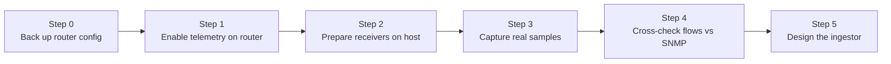

# Guide 01 — Telemetry setup and ingestion design

[Français](01-telemetry-and-ingestion.fr.md) | **English**

**Audience:** anyone reproducing the prototype, or an AI assistant picking up
the work.
**Goal:** get real telemetry flowing from the gateway router to the NAD host,
then design the ingestor from real samples.
**Status:** in progress. Flow export tested on 2026-10-15 (safe mode, reverted).
SNMP, syslog and the cross-check are not tested yet. Fill in the results log
(section 11) as you go.

Items marked **(verify)** depend on the RouterOS or tool version and must be
checked against current documentation.

## 1. Why this order

The order is: configure the router, prepare the host to receive, capture real
samples, cross-check them, and only then write the ingestor.

- **Parsers written from imagined formats get rewritten.** Real flow records
  have field names and quirks that are only visible once you capture some.
- **Each step has a visible result.** If something is wrong (no packets, empty
  SNMP answers), you know which link of the chain is broken.
- **The cross-check protects the whole project.** If flow data does not roughly
  match the router's own counters, every later result would be built on sand.

## 2. Mental model

The router talks to NAD over three channels. In plain words: NAD can *ask* the
router questions (SNMP), and the router can *send* two kinds of messages on its
own (flow summaries and event logs).

| Channel | Direction | Who starts it | Carries | Port |
|---|---|---|---|---|
| SNMP | NAD to router | NAD asks | Counters, CPU, memory | UDP 161 |
| Flows (NetFlow/IPFIX) | Router to NAD | Router pushes | Summaries of conversations | UDP 2055 (convention) |
| Syslog | Router to NAD | Router pushes | Events (interface down, login failed) | UDP 514 |

What follows from this:

- Configuring the router means telling it **where to send** and **who may ask**.
- The host must be **listening before** the router starts sending.
- Flows and syslog travel over UDP: there are no retries, so packets can be lost
  silently. This is why a cross-check exists.
- The router is only the **messenger**: on the host, every flow packet comes
  from the router, but its content describes the conversations of every user.

## 3. Prerequisites

- Access to the router (SSH or WinBox) with permission to change telemetry
  settings.
- A Linux host on the same LAN as the router (the future NAD host), preferably
  on a cable rather than Wi-Fi (flows and syslog are UDP, with no retries), with
  a fixed address (static DHCP lease).
- On the host: `tcpdump`, `nc` (netcat), `jq`, the Net-SNMP command-line tools
  (`snmpwalk`, `snmpget`), `rsyslog`, and `goflow2` (a release binary such as
  `goflow2-2.2.7-linux-amd64` works without installing Go).
- The router's clock synchronized (see step 1.4).

## 4. Workflow overview



In practice, step 2 (the host listening) must be ready **before** the router
starts exporting in step 1.

---

## 5. Step 0 — Safety net

**Why:** telemetry changes are small, but a mistake on a gateway can cut
connectivity. A backup and a way to undo make experimenting safe.

```
# Free storage first: the export is written to the router's own flash.
# Also gives the hardware model and RouterOS version (results log)
/system resource print

# Save the current configuration (before-nad.rsc) and check it exists
/export file=before-nad
/file print where name~"before-nad"

# FastTrack: no line under the "Flags" header means no FastTrack rule at all
/ip firewall filter print where action=fasttrack-connection
/ip firewall connection print count-only where fasttrack

# LAN layout: bridge name (often not just "bridge"), member ports
# (flag H = hardware offload), and subnets per interface
/interface bridge print
/interface bridge port print
/ip address print
```

From the host, download the backup and keep it outside the repository. If the
router's storage is nearly full, remove the file from the router afterwards:

```bash
mkdir -p ~/nad-private
scp <admin-user>@<router-ip>:before-nad.rsc ~/nad-private/
```

```
/file remove before-nad.rsc
```

- **Safe mode:** `Ctrl+X` turns it on and the prompt shows `<SAFE>`. Leaving
  safe mode with `Ctrl+X` **keeps** the changes; `Ctrl+D`, or a dropped
  session, **undoes** everything done since safe mode was turned on. During a
  test period, never leave with `Ctrl+X`.
- **Do not commit the export file.** It describes the network and includes the
  router's serial number.
- **Write down** from `/ip address print`: the LAN subnet, the WAN address (it
  may be dynamic) and any VPN subnet. The ingestor needs them (step 5).
- **About FastTrack:** on old RouterOS versions it hid traffic from flow
  export; the documentation states this restriction was removed in 6.33
  **(verify)**. Do not disable it on a production router: record it, and let
  the cross-check (step 4) show whether it matters.

## 6. Step 1 — Enable telemetry on the router

Replace `<nad-ip>` with the NAD host address, `<router-lan-ip>` with the
router's LAN address and `<lan-bridge>` with the bridge name found in step 0.
Check each command with `?` or `print`, because syntax can vary between
RouterOS versions **(verify)**.

### 1.1 Flows (who talks to whom)

**Why:** flow records show conversations (source, destination, ports, bytes).
They are the richest signal for detecting scans, floods and unusual
destinations.

```
# Turn flow export on for the LAN bridge.
# active-flow-timeout: report long transfers every minute instead of only at the end
# inactive-flow-timeout: close idle flows quickly
/ip traffic-flow set enabled=yes interfaces=<lan-bridge> active-flow-timeout=1m inactive-flow-timeout=15s

# Send flow records to the NAD host, NetFlow v9, UDP 2055.
# src-address is required: without it the router may send from 0.0.0.0,
# and Linux silently drops packets with that source address.
/ip traffic-flow target add dst-address=<nad-ip> src-address=<router-lan-ip> port=2055 version=9

# Verify
/ip traffic-flow print
/ip traffic-flow target print

# Load check: compare cpu-load and free-memory with the values from step 0,
# right after enabling and again 10 minutes later
/system resource print
```

**Observed on RouterOS 7.12 (hAP ac²):** exporting from the LAN bridge alone
records **both directions**, each flow once. Outbound flows carry the internal
host address. Inbound flows are recorded before reverse NAT, so their
destination is the router's WAN address, not the internal host. The flow cache
(32k entries by default) used about 6 MB of RAM.

Traffic between two LAN ports in hardware offload is switched by the switch
chip and never reaches the CPU, so it does not appear in flows. This is a known
limit, acceptable because most traffic goes to the Internet.

### 1.2 SNMP (counters and device health)

**Why:** SNMP gives interface throughput, CPU and memory. It is also the
reference against which flow data is checked. **Not tested yet.**

```
# Enable the SNMP service
/snmp set enabled=yes

# SNMPv3 user "nad": read-only, only the NAD host may ask, authenticated and encrypted
# (replace both passwords; never commit real ones)
/snmp community add name=nad addresses=<nad-ip>/32 read-access=yes write-access=no \
    security=private authentication-protocol=SHA1 authentication-password=CHANGE_ME \
    encryption-protocol=AES encryption-password=CHANGE_ME_TOO

# Verify
/snmp print
/snmp community print
```

**Why SNMPv3 and a /32 restriction:** older SNMP versions send a shared password
in clear text. Restricting to one address and read-only access limits the damage
if the credentials leak.

### 1.3 Syslog (events)

**Why:** device events (interface changes, failed logins) are useful context.
NAD uses them as counts per time window. **Not tested yet.**

```
# Define a destination: the NAD host, UDP port 514
/system logging action add name=nad target=remote remote=<nad-ip> remote-port=514 src-address=<router-lan-ip>

# Send informational and more severe messages to that destination
/system logging add topics=info,warning,error,critical action=nad

# Verify
/system logging action print
/system logging print
```

Setting `src-address` here too avoids the same source-address problem as flows
**(verify)**.

### 1.4 Time

**Why:** NAD aggregates everything into one-minute windows. If the router clock
is off, its data lands in the wrong window.

```
# Check that the router clock is synchronized
/system ntp client print
/system clock print
```

### 1.5 Undo after a test session

**Why:** during the test period nothing should stay on the production router.

```
# Remove the export target and restore the defaults
/ip traffic-flow target remove [find dst-address=<nad-ip>]
/ip traffic-flow set enabled=no interfaces=all active-flow-timeout=30m inactive-flow-timeout=15s

# Proof: an export shows only non-default settings, so no /ip traffic-flow
# line must appear below the header
/ip traffic-flow export
```

Then leave safe mode with `Ctrl+D` (undo), never `Ctrl+X` (keep).

---

## 7. Step 2 — Prepare the receivers on the host

**Why:** the router pushes flows and syslog without waiting. If nothing is
listening, those messages are lost.

If a host firewall is active (check with `sudo ufw status verbose`), allow the
router to reach the receivers. The rule only matches if the router really sends
from `<router-lan-ip>` (see `src-address` in step 1.1):

```bash
# Allow flows and syslog from the router only
sudo ufw allow from <router-lan-ip> to any port 2055 proto udp comment 'NAD netflow'
sudo ufw allow from <router-lan-ip> to any port 514 proto udp comment 'NAD syslog'
sudo ufw status numbered | grep NAD
```

### Flow receiver

```bash
mkdir -p ~/nad-samples

# Receive NetFlow on UDP 2055, decode it, print JSON lines, and keep a copy
# (check the exact flags with -h: they differ between versions)
./goflow2-2.2.7-linux-amd64 -listen netflow://:2055 -format json | tee ~/nad-samples/flows.jsonl
```

```bash
# In another terminal: do raw packets arrive, and from which source?
sudo tcpdump -ni <host-interface> udp port 2055
```

Use the real interface (for example `eth0`) rather than `-i any`: the `any`
pseudo-device prints a harmless "promiscuous mode not supported" warning.

Diagnose in three levels, in this order:

1. **`tcpdump` shows nothing:** router configuration or network path.
2. **`tcpdump` shows packets, but `nc` receives nothing:** something drops them
   between the network card and the application. `tcpdump` captures **before**
   the host firewall, so seeing packets proves nothing about delivery. Check the
   source address in `tcpdump` (`0.0.0.0` is dropped by Linux) and the firewall
   rule.
3. **`nc` receives, but `goflow2` writes nothing:** decoding. A few
   `template error` warnings at start are normal: NetFlow v9 data cannot be
   decoded until the router sends its template.

```bash
# Level 2 test: stop goflow2 first, then listen with a minimal tool
timeout 15 nc -ul 2055 | xxd | head -5
```

goflow2 also serves metrics on port 8080. If another service already uses that
port, start goflow2 with `-addr :9081`.

### SNMP check

```bash
# Walk the "bytes received per interface" table (ifInOctets)
# -v3 -l authPriv: SNMPv3 with authentication and encryption
snmpwalk -v3 -l authPriv -u nad -a SHA -A 'CHANGE_ME' -x AES -X 'CHANGE_ME_TOO' \
    <router-lan-ip> 1.3.6.1.2.1.2.2.1.10
```

SNMP is started by the host, so no inbound firewall rule is needed for it.

### Syslog receiver

```bash
sudo mkdir -p /var/log/nad
sudoedit /etc/rsyslog.d/10-nad.conf
```

```
# Listen for syslog on UDP 514
module(load="imudp")
input(type="imudp" port="514")

# Messages from the router go to their own file; "& stop" keeps them out of the
# general system log
if $fromhost-ip == '<router-lan-ip>' then /var/log/nad/router.log
& stop
```

```bash
sudo systemctl restart rsyslog
tail -f /var/log/nad/router.log
```

If the file stays empty, generate an event on the router (for example a login)
and check that the log file is writable by the syslog user.

---

## 8. Step 3 — Capture real samples

**Why:** real records are what the ingestor will be designed from.

- Run the receivers for 20 to 30 minutes while the network is used normally.
- Keep raw captures **outside Git**. Only a small anonymized excerpt belongs in
  `data/samples/`.
- Inspect one record to learn the field names, then summarize the capture:

```bash
F=~/nad-samples/flows.jsonl

# Pretty-print the first flow record
head -n 1 $F | jq .

# Direction split (adjust the LAN prefix and the WAN address)
jq -r 'if (.src_addr|startswith("<lan-prefix>")) then "outbound"
       elif .dst_addr=="<wan-ip>" then "inbound"
       else "other" end' $F | sort | uniq -c

# Distinct internal hosts seen
jq -r 'select(.src_addr|startswith("<lan-prefix>")) | .src_addr' $F | sort -u | wc -l

# Volume, to estimate storage per day
ls -lh $F

# The capture describes real people's activity
chmod 600 $F
```

**Volume:** each raw JSON line is about 1.3 KB, most of it unused fields (BGP,
MPLS, IPv6). On the reference network this is in the order of 1 GB of raw JSON
per day, hence the ingestor's field selection and file rotation.

A test session validates the **pipeline**, not the baseline. The baseline is
built later from continuous collection.

## 9. Step 4 — Cross-check flows against SNMP

**Why:** flow export can undercount (accelerated forwarding, hardware offload)
or overcount (the same traffic exported from several interfaces), and UDP can
drop packets. SNMP counters come from the interface itself and serve as the
reference. **Not tested yet.**

```bash
# 1) List interface names and indexes (ifDescr)
snmpwalk -v3 -l authPriv -u nad -a SHA -A 'CHANGE_ME' -x AES -X 'CHANGE_ME_TOO' \
    <router-lan-ip> 1.3.6.1.2.1.2.2.1.2

# 2) Read the 64-bit received-bytes counter twice, 5 minutes apart
#    (64-bit counters avoid wrap-around on fast links)
IFX=<ifIndex>
OID=1.3.6.1.2.1.31.1.1.1.6.$IFX
snmpget -v3 -l authPriv -u nad -a SHA -A 'CHANGE_ME' -x AES -X 'CHANGE_ME_TOO' <router-lan-ip> $OID
sleep 300
snmpget -v3 -l authPriv -u nad -a SHA -A 'CHANGE_ME' -x AES -X 'CHANGE_ME_TOO' <router-lan-ip> $OID
```

Compare **per direction**, because SNMP counts per interface while flows mix
both directions. Bytes received on the LAN bridge match outbound flows; bytes
received on the WAN interface match inbound flows. Use `in_if` to split them:

```bash
# 3) Over the same 5 minutes (start from a fresh file), sum flow bytes per
#    ingress interface
jq -s --argjson lan <lan-ifindex> 'map(select(.in_if == $lan) | .bytes) | add' ~/nad-samples/flows-crosscheck.jsonl
jq -s --argjson wan <wan-ifindex> 'map(select(.in_if == $wan) | .bytes) | add' ~/nad-samples/flows-crosscheck.jsonl
```

Expect rough agreement, not equality. The bridge counter is slightly higher
than outbound flows because it also counts traffic addressed to the router
itself (DNS queries, management). A large gap points to one of the causes in
section 12.

## 10. Step 5 — Design the ingestor

### Concept

In plain words, the ingestor is a sorting center. It reads raw files, drops each
event into the box for its minute, counts what is in each box, and writes one
row per box.

Four stages, each independent so a source can be swapped without touching the
rest:

1. **Read:** one adapter per source (flows, SNMP output, probes, logs).
2. **Normalize:** convert each event to a common internal form (UTC timestamp,
   direction, bytes, addresses).
3. **Aggregate:** assign events to one-minute windows and compute the features.
4. **Write:** store one row per window in the database.

### Design decisions

| Decision | Why |
|---|---|
| All timestamps in UTC, windows aligned to the minute | Avoids time zone and daylight-saving confusion; windows from different sources line up |
| Close a window only after a delay | Flow records arrive late (router timeouts); closing instantly would undercount |
| Idempotent writes (upsert on the window key) | Re-running the ingestor must never duplicate rows |
| Remember the read position per file | Resume after a stop without re-reading or skipping data |
| Direction from `in_if`/`out_if`, not from addresses | The WAN address is dynamic (DHCP); interface indexes are stable |
| Per-host features from outbound flows only | Inbound flows carry the WAN address (recorded before reverse NAT) |
| Address classes as configuration: internal (LAN, VPN), upstream (Starlink LAN), Internet | VPN traffic is internal company traffic; the Starlink LAN is neither internal nor Internet |
| Keep only the needed fields at read time | Raw records are ~1.3 KB, mostly unused fields |
| Assign a flow to the window of its end time | Simple and deterministic; with a 1-minute active timeout, a flow never spans more than two windows |
| Raw files compressed and rotated after ingestion | Raw flows are the bulky part; windows are tiny |

Fields used from goflow2 (v2.2.7): `time_flow_start_ns`, `time_flow_end_ns`,
`src_addr`, `dst_addr`, `src_port`, `dst_port`, `proto`, `bytes`, `packets`,
`in_if`, `out_if`, `tcp_flags`, `sampler_address`. Timestamps are in
nanoseconds.

Example configuration (values from the reference network):

```yaml
internal_subnets:
  - 192.168.30.0/24   # LAN users
  - 10.0.0.0/24       # WireGuard VPN (internal company traffic)
upstream_subnets:
  - 192.168.1.0/24    # Starlink router LAN (neither internal nor Internet)
lan_ifindex: <lan-ifindex>
wan_ifindex: <wan-ifindex>
```

### Draft schema (adjust after seeing real records)

```sql
-- One row per one-minute window, from flows, counters and logs
CREATE TABLE IF NOT EXISTS windows (
  window_start      INTEGER PRIMARY KEY,  -- unix seconds, UTC, aligned to the minute
  flows             INTEGER,
  bytes_up          INTEGER,
  bytes_down        INTEGER,
  packets_up        INTEGER,
  packets_down      INTEGER,
  distinct_hosts    INTEGER,              -- from outbound flows
  distinct_dests    INTEGER,
  distinct_ports    INTEGER,
  top_talker_share  REAL,                 -- from outbound flows
  cpu_pct           REAL,
  mem_pct           REAL,
  log_events        INTEGER,
  ingested_at       INTEGER
);

-- One row per window and probe target (several targets per window)
CREATE TABLE IF NOT EXISTS probe_windows (
  window_start  INTEGER,
  target        TEXT,                     -- e.g. Starlink router (first hop), Internet targets
  rtt_mean_ms   REAL,
  rtt_p95_ms    REAL,
  loss_pct      REAL,
  PRIMARY KEY (window_start, target)
);
```

Probes live in their own table because each window has one row per target.
Probing both the Starlink router and Internet targets tells a local link
problem apart from a satellite link problem.

## 11. Results log

Fill this in after each session. These values feed the decisions in
`docs/tools/tooling.md`.

| Item | Test session (safe mode) | Continuous collection |
|---|---|---|
| Date | 2026-10-15 | |
| Router model | hAP ac² (RBD52G), 4 × ARM 672 MHz, 128 MB RAM | |
| RouterOS version | 7.12 (stable) | |
| Router free storage | ~0.4 MB of 15.2 MB | |
| FastTrack enabled | No (no rule configured) | |
| CPU load before telemetry | 10 % (22 min after a reboot) | |
| CPU load with telemetry | 31 % (1 h later, not comparable yet) | |
| Free memory before / with telemetry | 46.9 MB / 41.1 MB | |
| Flow export interface choice | LAN bridge only: both directions, no double counting | |
| Flows total vs SNMP counters (ratio) | Not measured yet | |
| Flow field names noted | See step 5 | |
| Addresses in flows | Outbound: internal hosts. Inbound: router WAN address | |
| Syslog format observed | Not tested yet | |
| Notes | Double NAT behind the Starlink router; WireGuard VPN on the router; LAN ports in hardware offload | |

## 12. Troubleshooting

| Symptom | Likely cause | What to check |
|---|---|---|
| No packets in `tcpdump` on port 2055 | Router not exporting, wrong target address | `/ip traffic-flow target print`, same LAN |
| `tcpdump` shows packets, `nc` and `goflow2` receive nothing | Source address `0.0.0.0` (dropped by Linux as "martian") or host firewall | Source in `tcpdump`; target `src-address`; `sudo ufw status` |
| Firewall rule added but still nothing | Rule matches the router address, packets come from `0.0.0.0` | Set `src-address` on the target first |
| `template error` warnings in goflow2 | Template not received yet | Normal for the first seconds; restart goflow2 if it lasts more than 2 minutes |
| "promiscuous mode not supported" warning | `tcpdump -i any` | Harmless; use the real interface |
| goflow2 metrics unreachable on port 8080 | Port used by another service | `sudo ss -tlnp \| grep 8080`; start goflow2 with `-addr :9081` |
| SNMP times out | Wrong credentials, address restriction, service disabled | `/snmp print`, community restriction matches the host address |
| Syslog file empty | Port 514 blocked, wrong filter address, file permissions | `tcpdump` on UDP 514, `fromhost-ip` value, ownership of `/var/log/nad` |
| Flow bytes much lower than SNMP | Accelerated forwarding or hardware offload, packet loss | FastTrack rule, bridge port flags, UDP drops on the host |
| Flow bytes higher than SNMP | Same traffic exported from several interfaces | Export interface choice (`<lan-bridge>` versus `all`) |
| Windows misaligned between sources | Router clock not synchronized | `/system ntp client print` |
| Router CPU rises noticeably | Flow export load | `/tool profile duration=10s`; adjust timeouts or enable sampling |
| Configuration gone after closing SSH | Session closed while still in safe mode | Expected during tests; `Ctrl+X` keeps changes when you want them permanent |

## 13. Next steps

1. Test SNMP (step 1.2), then the cross-check (step 4).
2. Telegraf configuration for SNMP and probes (guide 02).
3. Ingestor skeleton under `src/nad/collect`, with adapters and tests on the
   captured samples.
4. Ansible roles that install and configure the receivers on the NAD host, so
   this guide's manual steps become repeatable.

## Glossary

- **Flow:** a summary of one conversation between two machines (addresses,
  ports, bytes, packets).
- **SNMP:** a standard protocol to ask a device for its counters and status.
- **Syslog:** a standard protocol for devices to send event messages.
- **Window:** a fixed slice of time (one minute) into which all events are
  grouped.
- **Idempotent:** running an operation twice gives the same result as running
  it once.
- **FastTrack:** a MikroTik feature that speeds up forwarding by bypassing part
  of the packet processing.
- **NAT:** the router replaces internal addresses with its own before sending
  traffic out. Behind the Starlink router, there are two NAT layers (double NAT).
- **Bridge:** a virtual switch grouping several ports into one LAN interface.
- **Hardware offload:** traffic switched by the switch chip without reaching the
  CPU; it does not appear in flow export.
- **Template (NetFlow v9):** a message describing the field layout; data
  records cannot be decoded before it arrives.
- **Safe mode:** a RouterOS session mode where changes are undone unless you
  explicitly keep them.
- **Martian packet:** a packet with an impossible source address (such as
  `0.0.0.0`), dropped by the Linux kernel.
